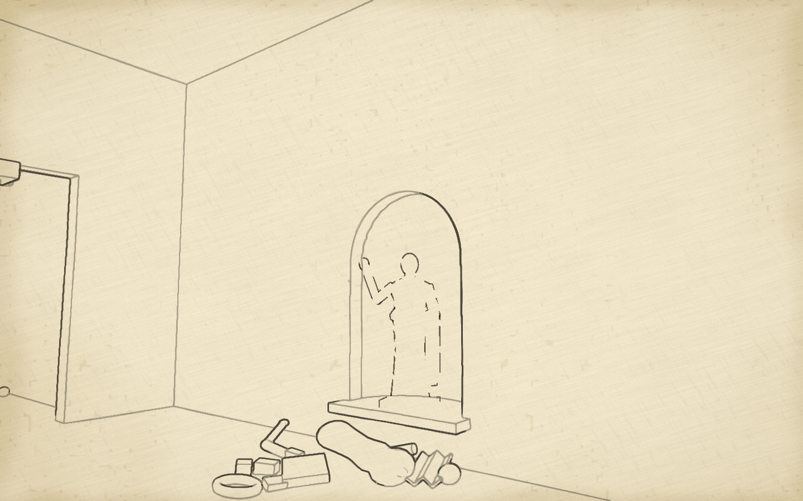
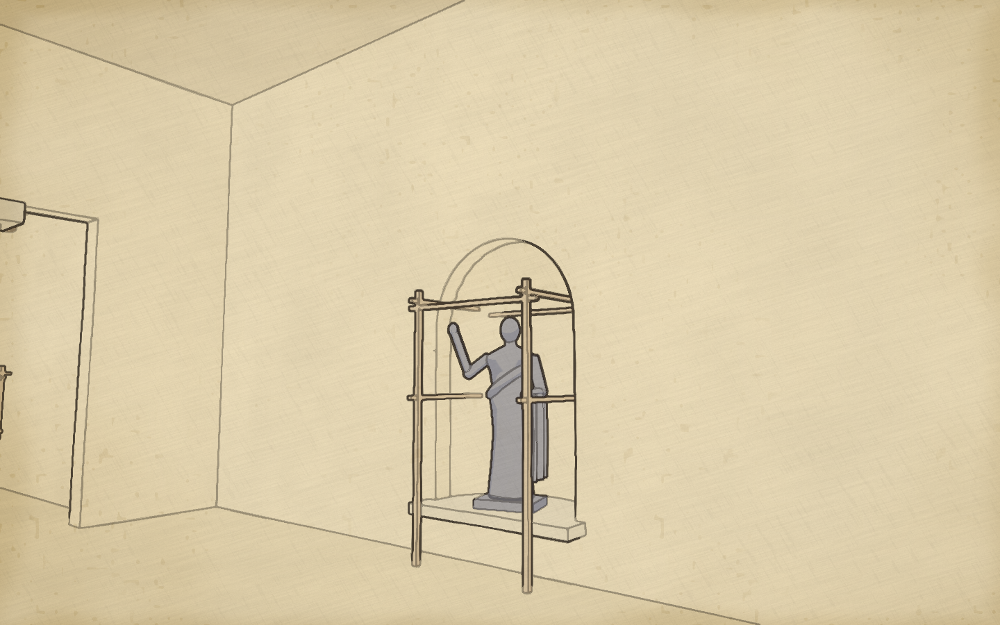
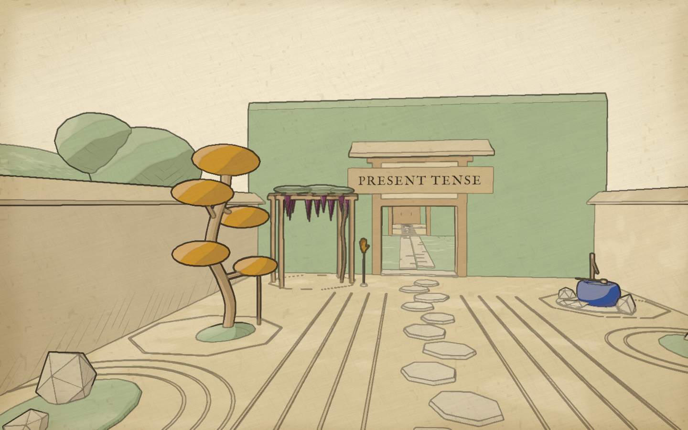
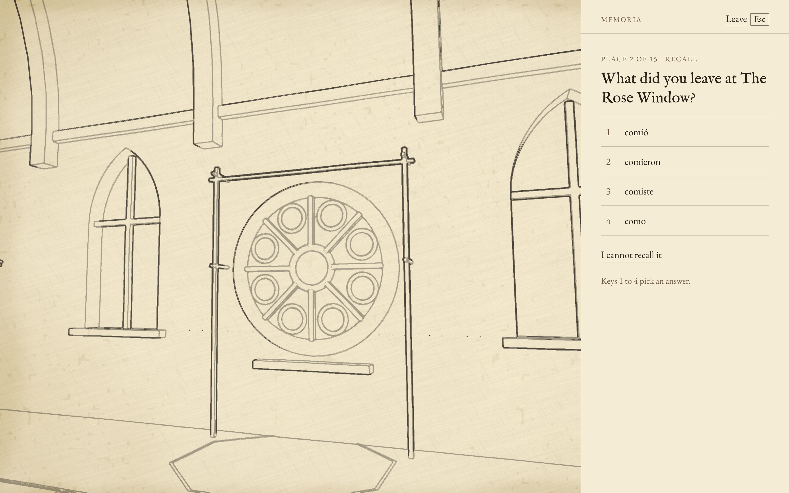
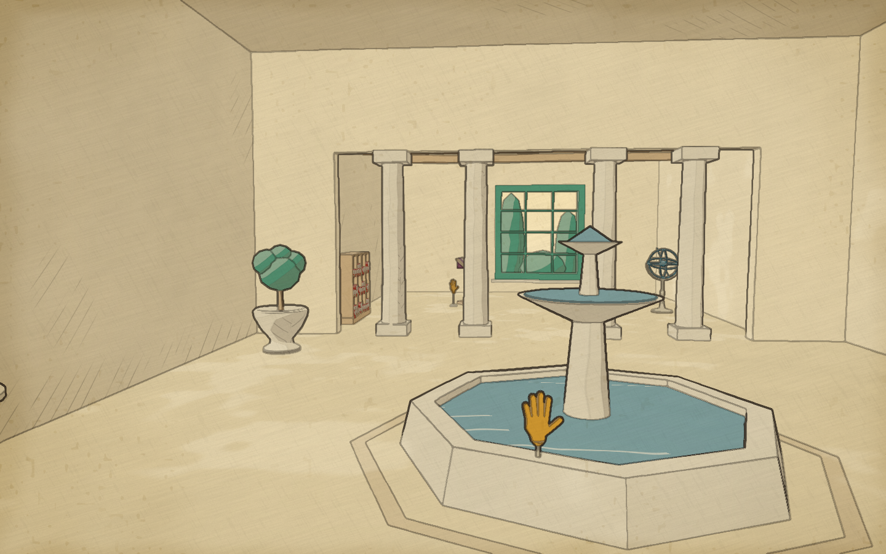
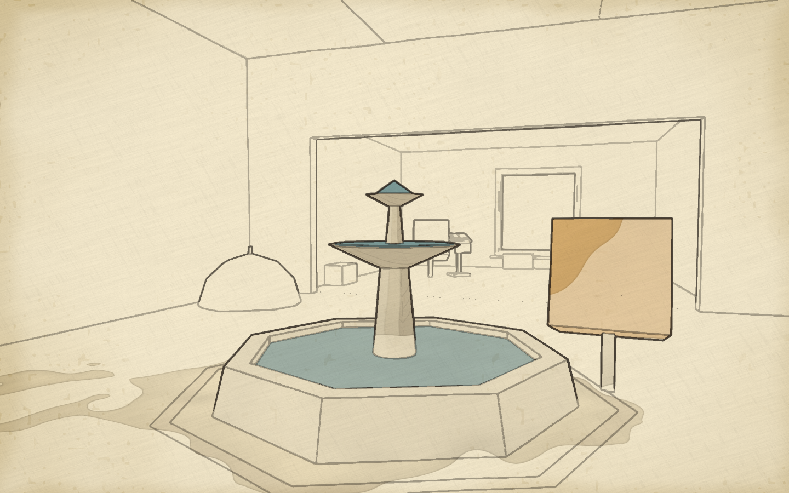
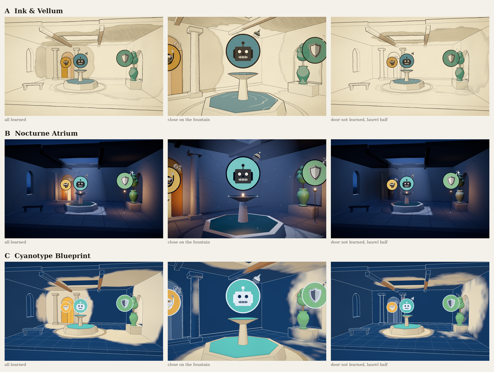

# Memoria

**Paste what you need to learn, and an AI architect turns it into a memory palace you can walk through.** It first asks what you already know and shows the answer as the state of the palace: a place you do not know yet is in ruins, a place you have studied is under repair, a place you have recalled is restored. Then it schedules your reviews.

| | | |
|---|---|---|
|  |  |  |
| In ruins: not known yet. A dashed outline of the whole object stays, so the place is still a landmark. | Under repair: studied, not yet recalled. | One palace, three states: ruins on the left, the fountain under repair, the window restored. |

## What is new (Part 2, Saturday 14 November)

On Saturday afternoon the team changed direction: the learner is the architect. This section is the state at Sat 5:45 PM ET. "Live" means on the deployed site since Sat 4:57 PM ET. "Merged" means on the working branch and going out with the next tested batch this evening. "Being built" means not finished; do not expect it on the site.

**The loop in three lines**

1. **Survey.** The first time you open a deck you walk the route and answer one question per place. There is an "I don't know" button, never preselected, and nothing is revealed. A place you get wrong, or mark "I don't know", collapses into ruin as you watch.
2. **Repair.** The study walk follows in the same session and shows your survey answer beside the right one. A studied place stands again inside a scaffold. A correct answer on the recall walk restores it. A later miss "needs another repair".
3. **Review.** Recall results schedule each place at growing intervals, and a Progress view keeps every survey, recall and review walk, with the survey labelled "before study".

A legend explains the three states wherever they appear. There are no points, badges or streaks.

**Options for the learner**

| Option | State | What it is |
|---|---|---|
| Rooms from categories | Live | A generated palace has one room per category: up to 5 places a room, 6 rooms, 30 places. The category name is inscribed over each doorway. |
| Palace style: Gothic library | Live | Stone halls with pointed arches, lancet windows and oak. |
| Palace styles: Zen garden, Workshop | Merged, not on the live site | The Workshop is the home of process decks: machines as stations, with a channel running from station to station. |
| Upload a PDF | Live | The text is read in your browser with PDF.js and becomes the notes. The file never leaves your device. Headings are marked. For a long PDF you choose the pages that fit the Architect's 12,000-character limit. Scans, locked files and damaged files are refused, each with its own sentence. |
| Larger palaces | Live | Up to 30 places. 28 landmarks that suit any style, plus each style's own, so 30 places are 30 different objects. |
| Progress view | Live | A chart per palace of every finished walk, and the weakest places. |
| Two showcase decks | Live | "Comer: one verb, three tenses" (three rooms) and "The citric acid cycle, as a cycle" (a process with links). Both were fact-checked; see [Status](#status). |
| Compose: choose a style, see the rooms and links, choose facts or process | Being built | |
| Extend a palace ("Add to this palace") | Being built | The Architect's half is live and measured. Nothing that exists ever moves when a palace grows; `scripts/palace-invariance.mjs` checks that over 63 palaces and 54 extensions. |
| Process mode in the walks | Being built | After each place of a process deck the learner is asked what the step becomes, and puts the steps in order, scored apart from the places. |
| Links drawn on the floor between places | Being built | The Architect already extracts the links. |

| | | |
|---|---|---|
|  |  |  |
| Gothic library (live). | Zen garden (merged, not on the live site). | Workshop (merged, not on the live site). |

**Honest limits of Part 2**

- We have not run an efficacy study of Memoria, and Part 2 adds three ideas (repair, rooms, links) that no published study has tested in a memory palace.
- Nothing has been checked on a real GPU: not the frame rate, not the collapse and rebuild in motion. Stills and automated tests only.
- PDF upload has been tested on synthetic PDFs only, not on real lecture PDFs. It reads PDFs that have a text layer; it does not read scans.
- The measurements of the Architect are single runs on the deployed site, not averages.
- No real people have used any of it yet, and it has not been tried with a screen reader.

What comes after tonight is under [Roadmap](#roadmap).

## Try it

Live demo: https://memoria-five-kappa.vercel.app (public, no login)

Press "Try it in 2 minutes" on the title screen. That is Judge Mode: it loads the eight carpal bones of the wrist with the palace in ruins, because you have not learned them yet. It walks you past one image per bone, and each place is rebuilt as you study it. Then it hides the images and asks what you left at each place; a right answer restores the place. A run in which nothing is skipped measures about two minutes (120 seconds with two seconds of thought per answer); it takes longer if you think longer. Timed stops can be paused with the Pause button or the P key. It runs with the network off.

For a live pitch, open `/?judge=pitch`. The button then reads "Try it in 90 seconds": each of the eight places is shown for 4 seconds, then three of the eight are spot-checked. Measured length with the palace starting in ruins: 80 seconds on a heavily loaded test machine (74 to 79 seconds before Part 2; starting in ruins adds no timer). Quiet-machine timing: (to fill in). A Judge run is a sandbox: it is not added to your reviews and never changes your saved decks.

To see the survey, press "Walk" on any palace you have not opened before, or build one with "Build a palace".

Demo video: [`docs/media/demo-pitch.mp4`](docs/media/demo-pitch.mp4), silent footage of the whole pitch run, 82 seconds. It was rendered offline, frame by frame on a virtual clock, by `scripts/capture.mjs`. It is not a screen recording from a laptop. **It shows the build from before Part 2** (no ruins, no scaffolds) and is to be re-rendered. Re-rendered: (to fill in).

## What it does

1. **Paste, or upload a PDF.** A list (one item per line, optionally `term - meaning`), raw notes, or a PDF whose text is read in your browser.
2. **The Architect proposes.** The Palace Architect picks the facts, sorts them into categories, decides whether they are separate facts or the steps of a process, drafts one image per fact, and assigns each to a place on a fixed route. Each category gets its own room. Links between facts are kept only where the notes support them.
3. **You read through and edit.** You see every image before anything is placed and can rewrite or regenerate any of them. Nothing forces an edit. A draft survives a reload.
4. **Survey.** The first time a deck is opened you walk the route and answer one question per place, or press "I don't know". Nothing is revealed. This is also your first walk of the empty route. If you skip the survey you take a short familiarization walk instead. Either way a two-question route check comes before any image is placed.
5. **Study walk.** The camera glides from place to place. At each one the image appears in the room with its term, meaning and scene, and your survey answer is shown beside the right one. The place goes under repair. You set the pace.
6. **Recall walk.** The same route with the images hidden. Each place asks "What did you leave at (this place)?" and the answer is the item's term, typed or multiple choice, before anything is revealed. A right answer restores the place. Typed answers ignore articles, brackets and small typos, and a typed miss can be overruled with "I was right" (the results then show it as self-marked). In multiple choice the right answer is dealt evenly across the options. Answers are saved as they are given, so a walk can be resumed after a reload. At the end you get a score and a tour of the places you just walked. For anything you missed, "Strengthen this image" offers another image; every item in the seven built-in decks has a hand-written alternate.
7. **Spaced review.** Recall results move each item through Leitner boxes with growing intervals. A first correct answer is next due tomorrow, a miss is due again in 10 minutes, and later gaps grow to 3, 7 and 21 days. A "due" view walks only the places that need review.
8. **Progress.** Every finished survey, recall and review walk is saved. The Progress view plots them per palace, with the survey as the score before study, and lists the weakest places.

There are two kinds of palace. The handcrafted one, "Domus", has twelve places in three rooms (the Vestibule, the Atrium, the Study); Judge Mode and five built-in decks use it: the eight carpal bones (Judge Mode), the twelve cranial nerves, the Mohs hardness scale, Spanish in the kitchen (term-and-meaning pairs) and the citric acid cycle. Generated palaces are built from the categories of your material, up to 30 places in 6 rooms; the two showcase decks use them.

Everything is stored in your browser's localStorage. There are no accounts. Saved data that is malformed is repaired or set aside, never shown as a blank page, and if something does go wrong an error page offers Reload and a guarded Reset.

The pictures below show the recall walk, the study walk and the results **in the build from before Part 2**. They are to be re-rendered; until then they do not show ruins, scaffolds or generated palaces. Re-rendered: (to fill in).


*One place on the recall walk: the question, a right answer, then the place takes full colour and an ink ring spreads on the floor.*

| | |
|---|---|
|  |  |
| Study walk: the image appears at its place with its term, meaning and scene. | Recall: "What did you leave at this place?", with the image hidden until you answer. |
|  |  |
| Results: the score, place by place, while the camera revisits the places just walked. | The atrium of the Domus with every place recalled. |
|  |  |
| Colour follows what you have recalled: unlearned places stay as line drawing. | First glaze: a place that holds an image but has not been recalled yet. |

## The comparison test

`/?compare` is a small test for volunteers, built so the team can collect honest, informal numbers. A volunteer learns one eight-item list as plain text and another by walking the palace (51 seconds each), does 20 seconds of sums after each, and answers eight ordered multiple-choice questions on each. Two lists exist in both forms (the carpal bones and the citric acid cycle), so which list goes in the palace is swapped between volunteers, as well as which comes first. The results table, the means and a CSV export stay on the device. The protocol and its limits are in [`docs/venue-test.md`](docs/venue-test.md).

No people have done it yet. The scores in `docs/media/ui-compare.png` were entered by a script. It is not a study, and we will not call it one.

## Why it should work, and what we do not claim

All of this comes from [`docs/research.md`](docs/research.md), which lists every source and how confident we are in it.

The technique:

- The oldest surviving description of the method of loci is in the *Rhetorica ad Herennium*, written around the 80s BCE. The palace follows the rules for places found there and in Cicero: a fixed order, distinct forms, no crowds, and a marker on every fifth place.
- Two meta-analyses report that the method of loci improves recall of lists by a medium-to-large margin (g = 0.65 across 13 randomised trials; d = 0.88 for immediate serial recall against rehearsal). Both flag a high risk of bias, and the 2025 review grades the evidence as low to very low quality.
- A 2012 study of 142 participants found that a virtual environment explored for about five minutes served as well as a familiar real place. That is why Memoria uses a fixed virtual route that you walk empty before anything is placed. Participants in that study imagined their items, so our rendered images go beyond what it tested.
- The palace only helps you encode. What the literature shows makes memories last is retrieval practice and spacing, so every palace ends in a recall walk with the images hidden, followed by scheduled reviews.

Part 2 (section 8 of the research brief):

- **The survey.** Memoria asks before it teaches: in laboratory studies, trying to answer before studying improved later memory for that answer even when the attempt failed, and a meta-analysis of questions asked before text and video lessons puts the gain at g = 0.54 for the facts asked about and about zero for anything else; the gain depends on studying the answers afterwards, and none of this was tested in a memory palace or in Memoria.
- **Answers, not confidence.** People are poor judges of what they know, and in one pair of studies students who over-rated their answers remembered less two days later, so Memoria decides which places need repair from your answers, not from how confident you feel.
- **The ruins.** The ruins are a map of your answers, not a reward system. Evidence that progress displays improve learning is thin (a 2024 review of 38 dashboard studies found no reliable gain in achievement), so we make no claim that the repair mechanic improves learning; we have not tested it.
- **Rooms and links.** Organised material is recalled far better than the same material in random order (two to three times better in Bower and colleagues' 1969 word hierarchies), which is why each category gets its own room; whether rooms or drawn links help inside a memory palace has not been tested, and the nearest evidence is for concept maps on a page (g = 0.58 against mixed comparison activities, Schroeder and colleagues 2018).
- **Thirty places, and extension.** Laboratory studies of the method of loci have used routes of about 20 to 40 places, so a 30-place palace is within the range studied for word lists; adding places to a palace later has not been studied, and we never put a second fact on a place that is in use, because reusing places is where interference has been reported.
- **Other tools.** Mnemorium is a free, open-source desktop app that builds palaces from your own photos, generates mnemonics with an AI key you supply, and schedules reviews with FSRS; memoryOS is a freemium mobile app that teaches memory techniques through lessons and ready-made 3D palaces. Memoria runs in the browser and starts with a diagnostic walk of your own notes, then shows the result as the state of the palace; we did not find a diagnostic step in either product's public description. That is what we saw in November 2026, not proof that the features are absent, and both products do things Memoria does not (your own rooms and offline data in Mnemorium; a taught course by a memory champion in memoryOS).

What we do not claim:

- **We have not run an efficacy study of Memoria**, and Part 2 adds three ideas (repair, rooms, links) that no published study has tested in a memory palace. It is a hackathon prototype with no outcome data of its own. Every claim above is about a technique, not about this app.
- Our sources were checked through abstracts and search extracts, not full texts. `docs/research.md` marks what was not re-checked.
- The evidence is mostly short laboratory studies with university students memorizing word lists. Classroom evidence is thin. The pretesting studies used texts, lectures, trivia questions and word pairs; a survey inside a 3D walk, sometimes on bare vocabulary, is an extrapolation, and the support is weaker for bare vocabulary pairs.
- Loci suit ordered, discrete facts. They do not teach understanding. Rooms for categories and links between places move away from the material for which loci were shown to help.
- A browser is the desktop condition. The one head-to-head study we found reported head-mounted VR better than desktop, and other work suggests navigation itself may not be the active ingredient. The 3D walk is there for structure and engagement, not as a proven memory boost.
- AI-supplied images are not known to work as well as images the learner invents. The research on supplied versus self-made mnemonics is mixed, which is why you can rewrite every image.
- The large gains in training studies followed about six weeks of daily practice in young adult men. We do not promise general memory improvement, only what is practised.
- Other AI-assisted memory palace tools exist, and we saw descriptions of projects that offer a walkable palace on the web, links between items, or scheduled palace reviews. Memoria is not the first, and we do not claim it is the only one at any of these.
- We make no claim that choosing a style helps learning. It was not researched.

## How it is built

**Stack.** Vite 8, React 19, TypeScript 6, three.js 0.187 with React Three Fiber 9, drei and postprocessing, zustand for state. WebGL2. The front end is static and deploys on Vercel. The only server code is one function, `api/architect.ts`. PDF.js (`pdfjs-dist`) is loaded only when a PDF is chosen.

**Layout, Theme, Style.** Three things are kept separate so that any palace works with any look:

- A **layout** (`src/layouts/`) is geometry plus the ordered route of places. Meshes never choose a colour. They name a semantic slot (`<Surface slot="wall" />`), and a place feature adds an accent role.
- A **theme** (`src/themes/*.json`) is a file of tokens: palette, light, fog, post-processing numbers, type, UI colours.
- A **style** (`src/styles/<id>/`) is code that turns theme tokens into materials, environment and post-processing.

The default look, Ink & Vellum, is a custom non-photorealistic pipeline: flat watercolour washes, ink outlines found from depth and surface direction, and paper grain, with no lights or shadow maps.

**Generated palaces.** A palace is described by a short specification that is part of its layout id: the architectural kit and, for each room, its name and how many places it holds. The generator turns that into rooms, doorways, places and the camera route. A palace grows only by adding places to rooms with space or by appending rooms, and nothing that exists ever moves: `scripts/palace-invariance.mjs` checks that every place is identical before and after an extension, over 63 palaces and 54 extensions. A kit (`src/layouts/kits/`) supplies the architecture: the Gothic library, the Zen garden and the Workshop. 28 landmarks belong to no kit, and each kit adds its own, so the 30 places of a full palace are 30 different objects.

**The state of a place.** The scene receives one number per place that says how whole it is. It comes only from the learner's answers: in ruins after a wrong or "I don't know" survey answer, under repair once studied, restored once recalled. With reduced motion a place changes state at once, with no flying pieces.

**The development field.** Every material can ask `developmentAt(worldPosition)`, a value from 0 to 1 that says how well the nearest place has been learned. Styles draw low values as unfinished and high values as complete. In the ink style an unlearned place is line on bare vellum, a place that holds an image carries a light first glaze, and a correct recall brings the full washes and pigment in around it, with an ink ring spreading on the floor.

**Camera.** The camera glides on a spline rail. Its turn rate is capped so that wide turns of the head stay calm, and the adaptive render resolution survives window resizes.

**The Palace Architect.** The server function works in steps, and the app shows each step to the learner in plain words:

1. *Plan*: choose the facts, decide whether the deck is an ordered list, term-and-meaning pairs or a process, sort the facts into categories (which become rooms), and keep links between facts only where the notes support them.
2. *Generate*: draft one image per fact, acting on the feature of its place.
3. *Self-check*: a second, strict pass checks every image against the image rules (concrete, doing something, different from its neighbours, tied to the meaning by a one-line reason).
4. *Revise*: the images that fail are rewritten.
5. *Adapt*: when you miss an item in a recall walk, you can ask for a stronger image for that item.
6. *Extend*: new facts are added to a palace without changing any image or place that already stands. The screen for this is being built; the function is live.

A large palace is planned as several short requests in parallel, each well under 30 seconds. The Anthropic key is read from the server environment and never reaches the browser. Results are cached. This live path has been run on the deployed site; what was measured is under [Status](#status).

**PDF upload.** The file is opened in the browser by PDF.js in a worker and never uploaded. Headings are marked, hyphenated line breaks are rejoined, and running headers and page numbers are dropped. The text then goes into the notes box, where the learner can edit it before the Architect sees it.

**The offline planner.** If the function is unreachable or has no key, the app falls back to a deterministic offline planner, so composing a palace still works without a network. From notes it keeps each whole sentence as the meaning and names the card with a noun phrase that is unique in the deck. It never repeats a picture within a deck. For vocabulary, the image depicts the meaning and quotes the word, in several sentence patterns. Its drafts are labelled as offline drafts in the app.

**Offline demo path.** Judge Mode and the built-in decks run from fixtures. Nothing on the demo path makes a network request.

## Run it locally

Needs a current Node.js.

```bash
npm install
npm run dev
```

For the live Architect, copy `.env.example` to `.env.local` and set `ANTHROPIC_API_KEY`. The dev server serves the same `api/architect.ts` handler that Vercel runs. Without a key the app uses its offline planner. `ARCHITECT_MODEL`, `ARCHITECT_EFFORT` and `ARCHITECT_THINKING` are optional overrides, described in `.env.example`. Extended thinking is off by default for the Architect's calls; `ARCHITECT_THINKING=adaptive` turns it back on (with it on, a six-fact plan took about 26 seconds in a single run, against about 11 with it off).

| Command | What it does |
|---|---|
| `npm run dev` | Vite dev server |
| `npm run build` | Type-check, then production build to `dist/` |
| `npm run check` | Type-check and lint |
| `npm run shots` | Headless screenshots of fixed camera bookmarks into `qa/shots/` |
| `node scripts/smoke.mjs` | End-to-end test of the learning loop in headless Chromium: Judge Mode (passive, with misses, offline and starting in ruins, the pitch variant), a keyboard-only compose, survey, study and recall, the survey's states and the Progress view, typed recall, drafts and walks that survive a reload, malformed saved data, the error page, and the Theme Lab buttons with real clicks. Run `npm run build` first. |
| `node scripts/pdf-smoke.mjs` | End-to-end test of "Upload a PDF": headings, a PDF longer than the limit, the refusals (a scan, a file that is not a PDF, a damaged PDF, a locked PDF), notes already in the box, and cancelling. The test PDFs are made by the script. Run `npm run build` first. |
| `node scripts/palace-invariance.mjs` | Check of generated palaces, with no browser: the same specification gives the same palace, nothing that exists moves when a palace is extended, and the camera route stays inside the rooms. |
| `node scripts/ab-smoke.mjs` | End-to-end test of the comparison test (`?compare`): two scripted participants with the lists swapped, the results table and CSV, and an abandoned run that stores nothing. Run `npm run build` first. |
| `node scripts/architect-smoke.mjs` | Checks the fixture decks, the offline planner and the API handler's guard rails. Calls the real model only when a key is set. |
| `node scripts/live-check.mjs --url <deployment> [--facts 12]` | Checks a deployed copy from the outside, in a real browser: the page is public, the API answers with its guard rails, the scene renders, "Build a palace" returns a plan (it reports whether the plan came from the live Architect or the offline planner, and how long it took), and Regenerate works. Anyone can run it to repeat the live check under Status. |
| `node scripts/capture.mjs` | Renders footage, GIFs and interface stills frame by frame on a virtual clock, so motion plays at the right speed on a machine that draws only a few frames a second. The commands that made the files in `docs/media/` are in its header. Needs `ffmpeg` for video and GIF output. |

`shots`, `smoke.mjs`, `pdf-smoke.mjs`, `ab-smoke.mjs`, `capture.mjs` and `live-check.mjs` need Playwright: `npm i -D playwright && npx playwright install chromium`.

## URL switches

| Parameter | Effect |
|---|---|
| `?judge` | Starts Judge Mode (about 2 minutes), with the palace in ruins |
| `?judge=pitch` | The pitch variant, under 90 seconds: waits on the title screen, shows each of eight places for 4 seconds, then spot-checks three of the eight. Measured 80 seconds on a loaded machine with the palace starting in ruins; 74 to 79 before Part 2 |
| `?compare` | The list-against-palace comparison test for volunteers (protocol in `docs/venue-test.md`). Order and material are drawn at random. |
| `?compare=list-first`, `?compare=palace-first` | The same test with the order fixed |
| `&palace=carpals`, `&palace=krebs` | Added to `?compare`: fixes which list is walked in the palace (the carpal bones or the citric acid cycle); the other one is the plain list |
| `?lab` | Theme Lab: a panel for tuning the active theme's tokens live, with Copy JSON, Download JSON and Reset |
| `?perf` | Frame-rate overlay |
| `?theme=<id>` | Use a theme by id, for example `?theme=ink-sanguine` |
| `?gallery` | Every landmark side by side, for checking that no two look alike |
| `?proto=1` | The art-direction test room used to compare the three prototypes |

## Themes

| Id | Status |
|---|---|
| `ink-vellum` | Default. Iron-gall ink line over vellum with mineral-pigment washes. |
| `ink-sanguine` | Palette variant of the same style: red chalk on cream paper. |
| `cyanotype` | Experimental. |
| `nocturne-atrium` | Experimental; a prototype from the art-direction comparison. |
| `greybox` | Plain fallback, and the simplest template for a new style. |



A theme is the look (ink, paper, pigment). A palace style, or kit, is the architecture (Gothic library, Zen garden, Workshop). Kits name surfaces by role, as every layout does, so a kit takes its colours from whichever theme is active.

To add a palette variant, copy the nearest JSON file in `src/themes/`, change its `id` and `name`, and edit the tokens. Themes are discovered automatically, so there is no code to write. A new style module is only needed when the way the picture is made changes. The full procedure, including the screenshot checks, is in [`.claude/skills/palace-theme-authoring/SKILL.md`](.claude/skills/palace-theme-authoring/SKILL.md).

## Accessibility

What exists today:

- **Keyboard only.** The whole loop can be done without a pointer: Right or Space for the next place, Left to go back, P to pause a timed stop. The end-to-end test composes a list and walks the survey, the route check, the study walk and the recall walk with the keyboard only. "I don't know" is never focused first and is never picked by Enter alone. The PDF button is reached with Tab and opened with Enter, and pages of a long PDF can be chosen with the keyboard.
- **Reduced motion.** Follows the operating system's setting and can be overridden under Settings on the title screen. The camera glide is replaced with a cross-fade, and a place changes state at once, with no falling pieces.
- **Contrast.** Overlay colours come from theme tokens, with a rule of at least 4.5:1 for text. The first QA review measured the overlay and found nothing below that; it has not been measured again since, and the Part 2 screens (survey, Progress, PDF) have not been measured.
- **Text size.** Overlay text is at least 16 px.
- **Structure.** The overlay has a main landmark and headings. It has not been tried with a screen reader.

## Status

State at Saturday 14 November, 5:45 PM ET. Final state at submission: (to fill in).

Checked by automated tests on the build that went live at 4:57 PM ET (commit `6e8e54e`):

- The end-to-end suite (`scripts/smoke.mjs`, 15 of 15 cases), the comparison-test suite (`scripts/ab-smoke.mjs`, 3 of 3), the PDF suite (`scripts/pdf-smoke.mjs`, 5 of 5), the Architect suite (`scripts/architect-smoke.mjs`) and the palace check (`scripts/palace-invariance.mjs`) all pass. `scripts/live-check.mjs` passes against the deployed site.
- `scripts/drive-walk.mjs` fails on its time budgets when the test machine is loaded. It did so on the build from before Part 2 as well, so it is listed here as not verified, not as a regression.
- The Theme Lab's Copy JSON, Download JSON and Reset buttons are exercised with real clicks by the end-to-end suite.
- Three QA reviews by reviewers with no knowledge of the build are in [`docs/qa/`](docs/qa/). They reviewed the build from before Part 2. The third judged it safe to demo with precautions and found no blockers; its three major issues were fixed afterwards and are covered by tests. A fourth review, of Part 2, is planned for this evening: (to fill in).

Checked on the deployed site, single runs, not averages:

- **The live Architect, Part 2 (Saturday evening).** A 30-fact palace in 6 rooms took 16 seconds as eight short parallel requests, and the self-check rewrote 19 of the 30 first drafts. A six-step process was recognised as a process, with every step linked, in 13 seconds. Extending a palace with two facts took 9 seconds, and nothing that already stood was touched. The older twelve-fact path took 14 seconds, and Regenerate about 2 seconds. Final figures: (to fill in).
- **The live Architect, first check (about 12:55 PM ET).** Measured with `scripts/live-check.mjs` (a real browser driving "Build a palace"), a six-fact plan took 11.3 seconds on the server (5.9 s to draft, 5.4 s for the self-check) and a full twelve-fact palace took 13.7 seconds (7.8 s to draft, 5.9 s for the self-check). The self-check rejected and rewrote 4 of 6 and 4 of 12 first drafts in those two runs, and Regenerate took about 3 seconds. Extended thinking was off (the default); the build sandbox's network proxy cuts off any request longer than 30 seconds, so nothing slower than that could be observed from there.

Fact-checked:

- **The two showcase decks.** Every statement in the two showcase decks was checked against standard references: Berg and colleagues' *Biochemistry* (8th edition) and the IUBMB enzyme list for the cycle, the Real Academia Española's model conjugation for the verb, and Merriam-Webster and Etymonline for word origins. We checked search extracts of those sources, not the full texts. Nothing was wrong. Nine English glosses in the Spanish deck fitted more than one verb form ("you ate"); each now names the person it means. That correction is merged and not yet on the live site. The deck leaves out vosotros, and its first room is the preterite, one of several past tenses.

Bugs fixed in Part 2:

- The scroll bar in the middle of the title screen.
- The statue's flicker at its base. The cause was two coplanar faces on the niche sill. The fix is confirmed in stills, not in motion.
- The right answer in multiple choice is now dealt evenly across the options.

Not verified:

- **Anything on a real GPU.** The target is 60 fps at 1440×900 on an integrated GPU. The frame rate has not been measured. Camera glides, the collapse and rebuild of a place, the recall flourish, the results tour and the flicker fix have been checked only in stills and offline-rendered frames, not live.
- **Any result with real people.** The comparison test is built and nobody has done it yet. Nobody outside the build has taken the survey.
- **Real lecture PDFs.** Synthetic PDFs only.
- **Screen readers.** Not tested.
- **A quiet-machine timing of the pitch run.** 80 seconds was measured under heavy load: (to fill in).
- **The Zen garden and the Workshop on the live site, the Compose screen for styles and links, "Add to this palace", process mode and links drawn on the floor.** Merged or being built, as the table at the top says: (to fill in).

Also:

- Moving an item to a different place by hand is not built.

## Roadmap

Being finished tonight, if it tests clean: the Compose screen (style, rooms, links, facts or process), "Add to this palace", process mode in the walks, links drawn on the floor, and the Zen garden and Workshop on the live site.

Next, as plans and not as features:

1. Run the comparison test and the survey with people.
2. Learning environments for other kinds of knowledge, from the team's notes: a systems garden where changing one variable shows its consequences, a decision labyrinth, a comparison gallery, a timeline, a simulation, a proof workshop.
3. An optional "things you know well" field, so that images draw on what the learner already knows.
4. Your own home as the palace, from a phone scan.
5. Reading scanned PDFs.
6. Ambient audio, AI-drawn images for the memory tokens, a palace editor (click to place or reorder places), a shareable palace link, a WebXR mode.

Later:

- A community theme gallery.
- Classroom mode: a teacher builds a palace and students walk it.
- Multilingual vocabulary packs.

Not planned: worlds, characters or settings from existing films, games or books. Copyrighted material is out, by the team's own rule.

Already built beyond the first plan: generated palaces (the first plan had one handcrafted palace and listed a second layout as a stretch goal), and the comparison test (`?compare`), with the two lists and the order swapped between volunteers.

## Built at HackPrinceton Fall 2026

Education track. Team: Alex Wang, Richard Xu, Eric Wang, Eric Chen.

The code was written with Claude Code agents under the team's direction during the hackathon window. The team chose the idea, the scope and the art direction, and reviewed the result. The agent roles and the rules they worked under are in [`CLAUDE.md`](CLAUDE.md) and [`.claude/agents/`](.claude/agents/).

## License and credits

MIT. See [LICENSE](LICENSE). Third-party libraries, fonts and assets are listed in [CREDITS.md](CREDITS.md). Geometry and shaders are procedural and original unless listed there.
