# Memoria

**Paste what you need to learn, and an AI architect turns it into a memory palace you can walk through.** It first asks what you already know and shows the answer as the state of the palace: a place you do not know yet is in ruins, a place you have studied is under repair, a place you have recalled is restored. Then it schedules your reviews.

| | | |
|---|---|---|
|  |  | 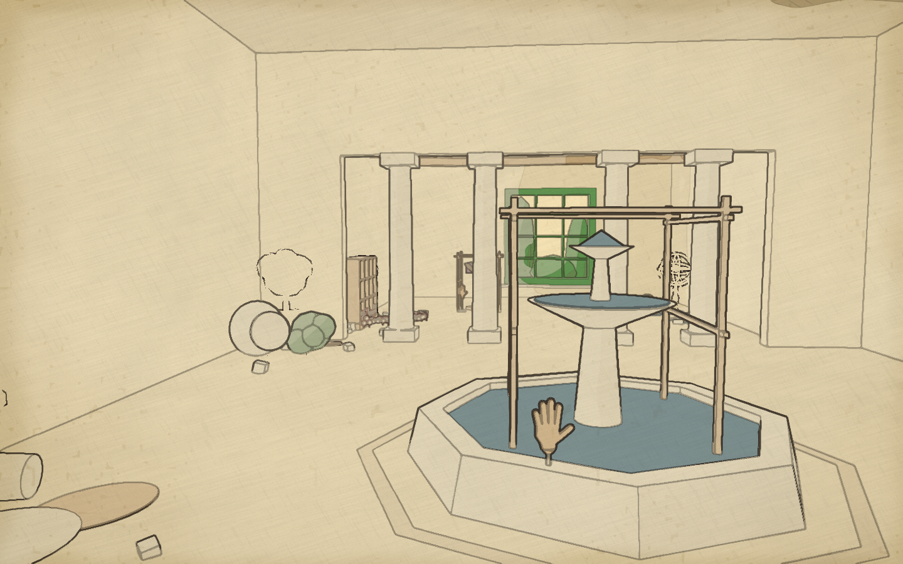 |
| In ruins: not known yet. A dashed outline of the whole object stays, so the place is still a landmark. | Under repair: studied, not yet recalled. | One palace, three states: ruins on the left, the fountain under repair, the window restored. |

## What is new (Part 2, Saturday 14 November)

On Saturday afternoon the team changed direction: the learner is the architect. This section is the state at Sat 9:30 PM ET. Everything in it is written as it stands on the deployed site. The last batch of the evening was still under test at that hour; what was in it, and whether it has been confirmed on the live site, is under [Status](#status). Since then, in the early hours of Sunday: a short demo of about 75 seconds on the five stages of the cell cycle (see [Try it](#try-it)), which also replaced the citric acid cycle as the process showcase, and four smaller changes listed under [Status](#status).

**The loop in three lines**

1. **Survey.** The first time you open a deck you walk the route and answer one question per place. There is an "I don't know" button, never preselected. The right answer is not shown; the place stands or falls as you answer. A place you get wrong, or mark "I don't know", collapses into ruin as you watch. The walk then moves on by itself, so it is one press per place.
2. **Repair.** The study walk follows in the same session and shows your survey answer beside the right one. A studied place stands again inside a scaffold. A correct answer on the recall walk restores it. A later miss "needs another repair". A place you answered right in the survey is "standing", not "restored", until you recall it after study.
3. **Review.** Recall results schedule each place at growing intervals, and a Progress view keeps every survey, recall and review walk, with the survey labelled "before study".

A legend names the states wherever they appear: in ruins, under repair, restored, and the two in between (standing: answered in the survey, not yet recalled; needs another repair: missed in a recall). There are no points, badges or streaks.

**Options for the learner**

| Option | What it is |
|---|---|
| Rooms from categories | A generated palace has one room per category: up to 5 places a room, 6 rooms, 30 places. The category name is inscribed over each doorway. |
| Three palace styles | A Gothic library (stone halls with pointed arches, lancet windows and oak), a Zen garden, and a Workshop, the home of process decks: machines as stations, with a channel running from station to station. The handcrafted Roman house is the fourth choice. |
| A palace of its own | Every new palace is furnished from its own seed. Two palaces in one style have the same architecture and the objects in a different order: measured over every pair of 160 seeds in each style, about 6% of the places of two 30-place palaces hold the same object. The built-in decks are unchanged. |
| Compose | Paste notes or upload a PDF. Choose the architecture or let the Architect choose. Read the proposals room by room, choose facts or process, check the links under "How these connect", and save. |
| Add to this palace | New facts go into free places or into a new room at the end. Nothing already placed moves, and only the new places are surveyed and studied. |
| Edit | A saved palace is edited in place: its name, a room's name, a term, a meaning, an image. Nothing moves. Changing a fact sends its place back for repair, and the facts you did not touch keep their progress. |
| Process decks | When the notes describe a process, each place of the walk also asks what happens to that step next ("What happens to Interphase next?": the chromosomes coil up) and never shows the next place's answer. The walk ends with an ordering task. Both are scored apart from the places. |
| Links drawn on the floor | Lines between related places, in four kinds told apart by the line alone. |
| Upload a PDF | The text is read in your browser with PDF.js and becomes the notes. The file never leaves your device. Headings are marked, a list stays a list, a slide bullet that wraps is one line, and a table row is one fact. For a long PDF you choose the pages that fit the Architect's 12,000-character limit. Scans, locked files and damaged files are refused, each with its own sentence. |
| Larger palaces | Up to 30 places. Within a palace no object stands twice, so 30 places are 30 different objects. |
| Exam Mode | A quiz on a plain sheet, with the palace and the images hidden and the questions shuffled, from term to meaning or from meaning to term. Afterwards you walk back to exactly the places you missed. An exam is recorded in Progress and changes no review schedule. |
| Progress view | A chart per palace of every finished walk, and the weakest places. Exams are listed in its table and kept off the chart's line, because they are asked without the palace. |
| Offline copy | After one visit online, a reload with the network off still opens the app, and Judge Mode runs. Tested in headless Chromium only. |
| Two showcase decks | "Comer: one verb, three tenses" (three rooms) and "The five stages of the cell cycle" (a process with links, in one hall of the Workshop; also the short demo). The Spanish deck was fact-checked (see [Status](#status)); the cell cycle deck, added early on Sunday, has not been. |

| | | |
|---|---|---|
| 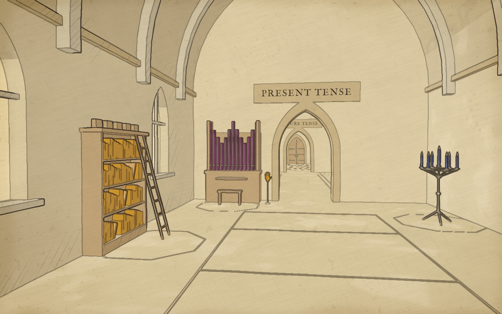 |  | 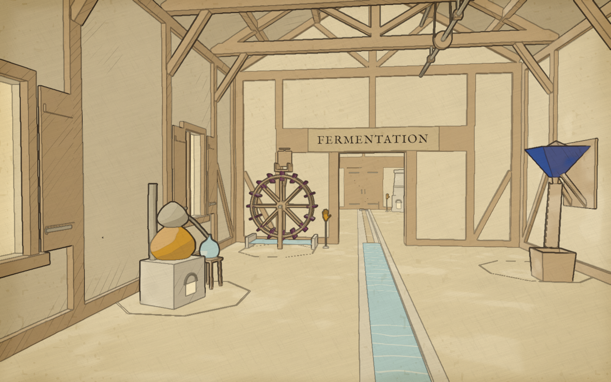 |
| Gothic library. | Zen garden. | Workshop. |

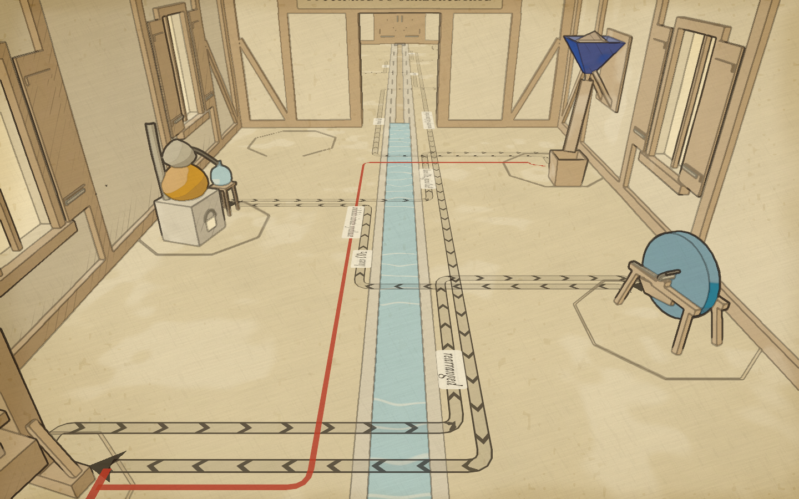

*Links drawn on the floor of a process deck: each stage of the cell cycle is joined to the next by a lane with its label, and the last lane leads from telophase back to interphase.*

**Honest limits of Part 2**

- We have not run an efficacy study of Memoria, and Part 2 adds three ideas (repair, rooms, links) that no published study has tested in a memory palace.
- Nothing has been checked on a real GPU: not the frame rate, not the collapse and rebuild in motion. Stills and automated tests only.
- PDF upload has been tested on PDFs we generated, not on real lecture PDFs. It reads PDFs that have a text layer; it does not read scans.
- The offline copy has been tested in headless Chromium only, not in other browsers.
- The measurements of the Architect are single runs on the deployed site, not averages.
- No real people have used any of it yet, and it has not been tried with a screen reader.
- The five built-in decks on the handcrafted Roman house still share one route. Whether different furnishing is enough to keep two topics in one style apart has not been tested.

What comes next is under [Roadmap](#roadmap).

## Try it

Live demo: https://memoria-five-kappa.vercel.app (public, no login)

Press "Try it in 2 minutes" on the title screen. That is Judge Mode: it loads the eight carpal bones of the wrist with the palace in ruins, because you have not learned them yet, and the screen says so: "In ruins: you have not learned these yet. Each place is rebuilt as you study it." It walks you past one image per bone, and each place is rebuilt as you study it. Then it hides the images and asks what you left at each place; a right answer restores the place. A run in which nothing is skipped measured about two minutes before Part 2 (120 seconds with two seconds of thought per answer); we have no later figure for the full run. Timed stops can be paused with the Pause button or the P key. It runs with the network off.

For a live pitch, open `/?judge=pitch`. The button then reads "Try it in 90 seconds": each of the eight places is shown for 4 seconds, then three of the eight are spot-checked. Measured by the fourth QA review, with a script giving each answer within 2 seconds on a loaded test machine: 69.9 seconds in all (the study walk 47.2 seconds from the button, 3 seconds on the screen between, the spot check 19.6 seconds). Earlier runs the same day under heavier load took 80 to 94 seconds. Timing on a quiet machine with a person answering: (to fill in). A Judge run is a sandbox: it is not added to your reviews and never changes your saved decks.

For a shorter demo, open `/?judge=short`. The button reads "Try it in 75 seconds". It loads the five stages of the cell cycle, in order (interphase, prophase, metaphase, anaphase, telophase), into one hall of the Workshop as a process: five stations (the screw press, the grindstone, the alembic still, the hopper and chute, the water wheel), each stage linked to the next on the floor and the last back to the first. The hall starts in ruins; each station is rebuilt as it is studied (3.5 seconds an image), then all five are asked. To keep it short, this Judge run asks no questions about the links and has no ordering task; walked from the list of palaces, the same deck asks both. Measured with a script giving two seconds of thought per answer, with the network off, on a loaded test machine: 67 seconds from the button to the results. Timing on the demo laptop with a person answering: (to fill in).

To see the survey, press "Walk" on any palace you have not opened before, or build one with "Build a palace".

Demo video: [`docs/media/demo-pitch.mp4`](docs/media/demo-pitch.mp4), silent footage of the whole pitch run, 80.6 seconds: the palace in ruins at the start, each place rebuilt as it is studied, the spot check, and the results with the legend. Re-rendered from the Part 2 build on Saturday night. It was rendered offline, frame by frame on a virtual clock, by `scripts/capture.mjs`, with WebGL drawn in software; it is not a screen recording from a laptop, so it shows the right speed but not a real GPU's frame rate. Footage of the short run, `docs/media/demo-short.mp4`: (to fill in when rendered).

## What it does

1. **Paste, or upload a PDF.** A list (one item per line, optionally `term - meaning`), raw notes, or a PDF whose text is read in your browser.
2. **The Architect proposes.** The Palace Architect picks the facts, sorts them into categories, decides whether they are separate facts or the steps of a process, drafts one image per fact, and assigns each to a place on a fixed route. Each category gets its own room. Links between facts are kept only where the notes support them. You choose the architecture, or leave the choice to the Architect, which says why it chose.
3. **You read through and edit.** You see every image, room by room, before anything is placed and can rewrite or regenerate any of them. "How these connect" lists the links, and you can add or remove one. Nothing forces an edit. A draft survives a reload.
4. **Survey.** The first time a deck is opened you walk the route and answer one question per place, or press "I don't know". The right answer is not shown; the place stands or falls, and the walk moves on by itself. This is also your first walk of the empty route. If you skip the survey you take a short familiarization walk instead. Either way a two-question route check comes before any image is placed.
5. **Study walk.** The camera glides from place to place. At each one the image appears in the room with its term, meaning and scene, and your survey answer is shown beside the right one. The place goes under repair. You set the pace.
6. **Recall walk.** The same route with the images hidden. Each place asks "What did you leave at (this place)?" and the answer is the item's term, typed or multiple choice, before the image is shown again. A right answer restores the place. Typed answers ignore articles, brackets and small typos. A typed miss can be overruled with "I was right": the answer is then shown as self-marked and counted in the score, but the place stays under repair and its review stays in the first box, so the next real recall decides. In multiple choice the right answer is dealt evenly across the options. Answers are saved as they are given, so a walk can be resumed after a reload. At the end you get a score and a tour of the places you just walked. For anything you missed, "Strengthen this image" offers another image; every item in the seven built-in decks has a hand-written alternate.
7. **Process decks.** When the deck is a process, the recall walk also asks what happens to each step next and ends with an ordering task. These are scored apart from the places, and no question shows the answer of a place that is still to be asked.
8. **Spaced review.** Recall results move each item through Leitner boxes with growing intervals. A first correct answer is next due tomorrow, a miss is due again in 10 minutes, and later gaps grow to 3, 7 and 21 days. A "due" view walks only the places that need review.
9. **Add and edit.** "Add to this palace" appends facts without moving anything, and only the new places are surveyed and studied. "Edit" changes a saved palace in place; a changed fact sends its place back for repair.
10. **Exam Mode.** Once a deck has been studied, "Exam" asks its facts on a plain sheet: no palace, no images, the order shuffled, from term to meaning or from meaning to term. Nothing is marked until the paper is handed in. Afterwards you walk back to exactly the places you missed. An exam is recorded in Progress and changes no review schedule and no place.
11. **Progress.** Every finished survey, recall and review walk is saved. The Progress view plots them per palace, with the survey as the score before study, and lists the weakest places.

There are two kinds of palace. The handcrafted one, "Domus", has twelve places in three rooms (the Vestibule, the Atrium, the Study); Judge Mode and four of the built-in decks on the list use it: the eight carpal bones (Judge Mode), the twelve cranial nerves, the Mohs hardness scale and Spanish in the kitchen (term-and-meaning pairs). The citric acid cycle list of the comparison test is kept there too, off the list of palaces. Generated palaces are built from the categories of your material, up to 30 places in 6 rooms, in one of three styles; the two showcase decks use them: the five stages of the cell cycle in the Workshop (the deck of the short demo) and a Spanish verb in three rooms of the Gothic library.

Everything is stored in your browser's localStorage. There are no accounts. Saved data that is malformed is repaired or set aside, never shown as a blank page, and if something does go wrong an error page offers Reload and a guarded Reset. If the browser's storage is full when a palace is saved, Compose says that nothing was saved and keeps the notes and images; the palaces already stored stay as they were.

The clips and screenshots below were re-rendered from the Part 2 build on Saturday night, in the same way as the demo video.

| | |
|---|---|
| 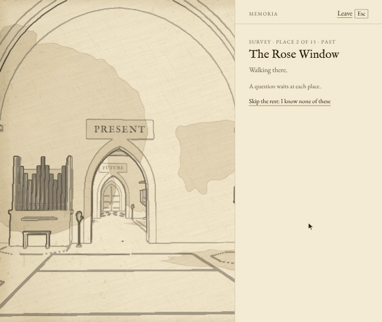 | 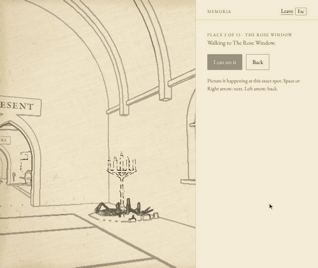 |
| The survey: "I don't know", and the place falls. A dashed outline of it stays. | Study puts it back inside a scaffold; a right answer on the recall walk restores it. (Two takes with a cut between them.) |


*One place on the recall walk: the question, a right answer, then the place takes full colour and an ink ring spreads on the floor.*

| | |
|---|---|
|  |  |
| Study walk: the image appears at its place with its term, meaning and scene. | Recall: "What did you leave at this place?", with the image hidden until you answer. |
| 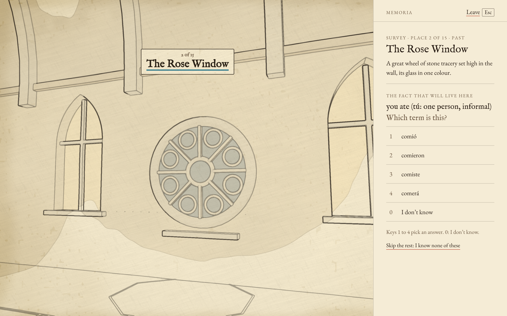 | 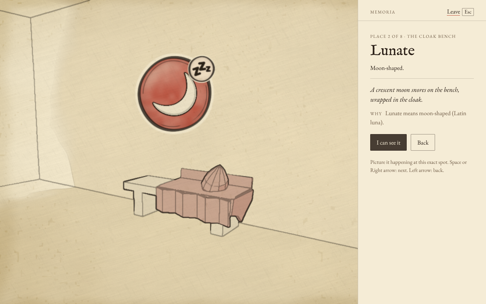 |
| The survey: one question per place, "I don't know" always there. | Study: "In the survey you said: I don't know.", then the term, meaning and image. |
| 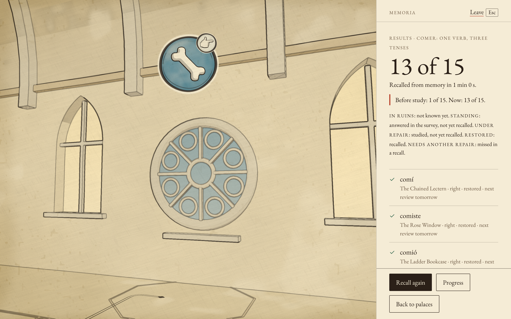 | 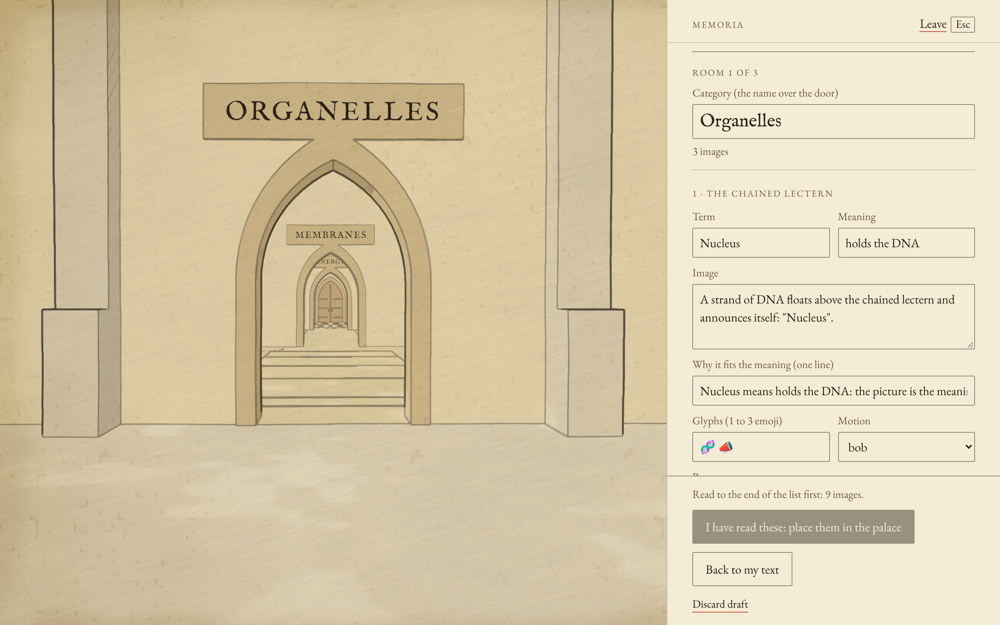 |
| Results: before study against now, place by place, with the legend. | Build a palace: the proposal by room, the palace already standing behind it. |
| 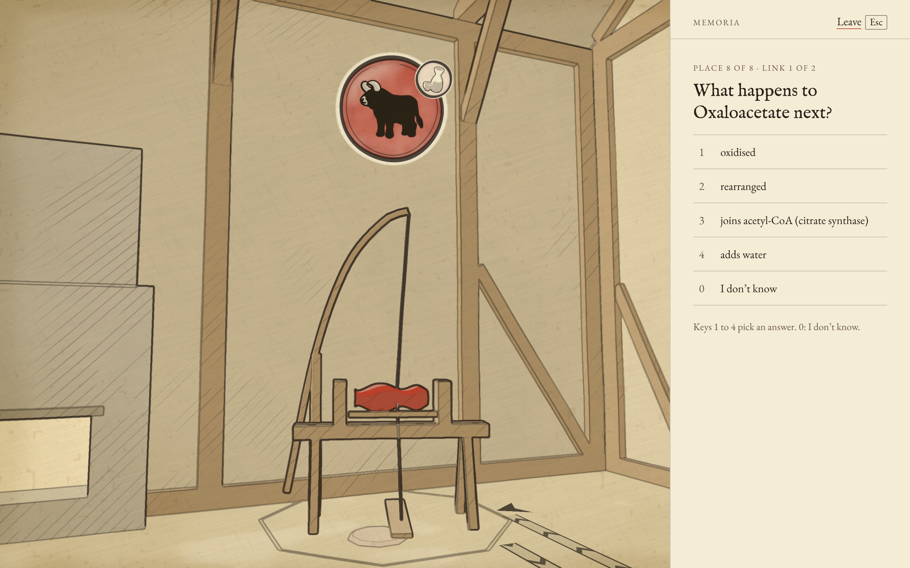 | 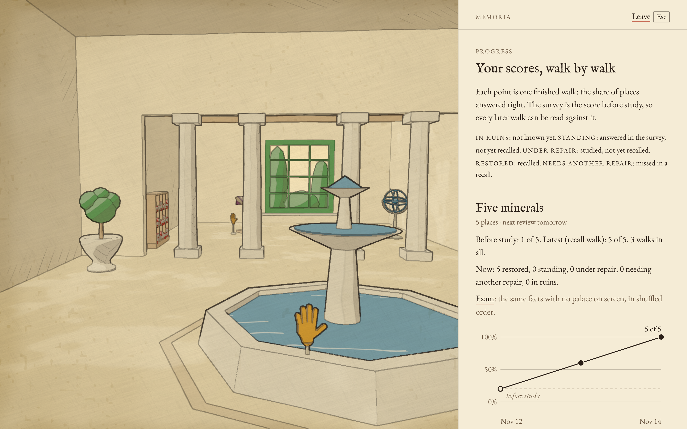 |
| A process deck: after the place, what happens to the step next. Links on the floor. | Progress: every walk, the survey as "before study". (Seeded history: the numbers are made up.) |
| 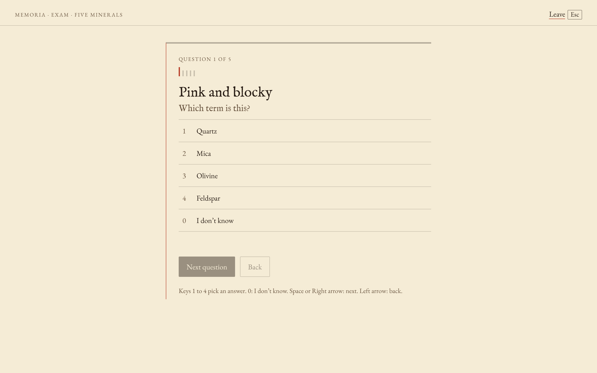 |  |
| Exam Mode: no palace, shuffled order. | The atrium of the Domus with every place recalled. |
|  |  |
| Colour follows what you have recalled: unlearned places stay as line drawing. | First glaze: a place that holds an image but has not been recalled yet. |

## The comparison test

`/?compare` is a small test for volunteers, built so the team can collect honest, informal numbers. A volunteer learns one eight-item list as plain text and another by walking the palace (51 seconds each), does 20 seconds of sums after each, and answers eight ordered multiple-choice questions on each. Two lists exist in both forms (the carpal bones and the citric acid cycle), so which list goes in the palace is swapped between volunteers, as well as which comes first. The results table, the means and a CSV export stay on the device. The protocol and its limits are in [`docs/venue-test.md`](docs/venue-test.md).

No people have done it yet. The scores in `docs/media/ui-compare.png` were entered by a script. It is not a study, and we will not call it one.

## Why it should work, and what we do not claim

All of this comes from [`docs/research.md`](docs/research.md), which lists every source and how confident we are in it.

The technique:

- The oldest surviving description of the method of loci is in the *Rhetorica ad Herennium*, written around the 80s BCE. The palace follows the rules for places found there and in Cicero: a fixed order, distinct forms, no crowds, and a marker on every fifth place.
- Two meta-analyses report that the method of loci improves recall of lists by a medium-to-large margin (g = 0.65 across 13 randomised trials; d = 0.88 for immediate serial recall against rehearsal). Both flag a high risk of bias, and the 2025 review grades the evidence as low to very low quality.
- A 2012 study of 142 participants found that a virtual environment explored for about five minutes served as well as a familiar real place. That is why Memoria uses a fixed virtual route that you walk empty before anything is placed. Participants in that study imagined their items, so our rendered images go beyond what it tested.
- The palace only helps you encode. What the literature shows makes memories last is retrieval practice and spacing, so every palace ends in a recall walk with the images hidden, followed by scheduled reviews.

Part 2 (section 8 of the research brief):

- **The survey.** Memoria asks before it teaches: in laboratory studies, trying to answer before studying improved later memory for that answer even when the attempt failed, and a meta-analysis of questions asked before text and video lessons puts the gain at g = 0.54 for the facts asked about and about zero for anything else; the gain depends on studying the answers afterwards, and none of this was tested in a memory palace or in Memoria.
- **Answers, not confidence.** People are poor judges of what they know, and in one pair of studies students who over-rated their answers remembered less two days later, so Memoria decides which places need repair from your answers, not from how confident you feel. That is why "I was right" does not restore a place.
- **The ruins.** The ruins are a map of your answers, not a reward system. Evidence that progress displays improve learning is thin (a 2024 review of 38 dashboard studies found no reliable gain in achievement), so we make no claim that the repair mechanic improves learning; we have not tested it.
- **Rooms and links.** Organised material is recalled far better than the same material in random order (two to three times better in Bower and colleagues' 1969 word hierarchies), which is why each category gets its own room; whether rooms or drawn links help inside a memory palace has not been tested, and the nearest evidence is for concept maps on a page (g = 0.58 against mixed comparison activities, Schroeder and colleagues 2018).
- **Thirty places, and extension.** Laboratory studies of the method of loci have used routes of about 20 to 40 places, so a 30-place palace is within the range studied for word lists; adding places to a palace later has not been studied, and we never put a second fact on a place that is in use, because reusing places is where interference has been reported.
- **Other tools.** Mnemorium is a free, open-source desktop app that builds palaces from your own photos, generates mnemonics with an AI key you supply, and schedules reviews with FSRS; memoryOS is a freemium mobile app that teaches memory techniques through lessons and ready-made 3D palaces. Memoria runs in the browser and starts with a diagnostic walk of your own notes, then shows the result as the state of the palace; we did not find a diagnostic step in either product's public description. That is what we saw in November 2026, not proof that the features are absent, and both products do things Memoria does not (your own rooms and offline data in Mnemorium; a taught course by a memory champion in memoryOS).

What we do not claim:

- **We have not run an efficacy study of Memoria**, and Part 2 adds three ideas (repair, rooms, links) that no published study has tested in a memory palace. It is a hackathon prototype with no outcome data of its own. Every claim above is about a technique, not about this app.
- Our sources were checked through abstracts and search extracts, not full texts. `docs/research.md` marks what was not re-checked.
- The evidence is mostly short laboratory studies with university students memorizing word lists. Classroom evidence is thin. The pretesting studies used texts, lectures, trivia questions and word pairs; a survey inside a 3D walk, sometimes on bare vocabulary, is an extrapolation, and the support is weaker for bare vocabulary pairs.
- Loci suit ordered, discrete facts. They do not teach understanding. Rooms for categories and links between places move away from the material for which loci were shown to help.
- A browser is the desktop condition. The one head-to-head study we found reported head-mounted VR better than desktop, and other work suggests navigation itself may not be the active ingredient. The 3D walk is there for structure and engagement, not as a proven memory boost.
- AI-supplied images are not known to work as well as images the learner invents. The research on supplied versus self-made mnemonics is mixed, which is why you can rewrite every image.
- The large gains in training studies followed about six weeks of daily practice in young adult men. We do not promise general memory improvement, only what is practised.
- Other AI-assisted memory palace tools exist, and we saw descriptions of projects that offer a walkable palace on the web, links between items, or scheduled palace reviews. Memoria is not the first, and we do not claim it is the only one at any of these.
- We make no claim that choosing a style helps learning, that a differently furnished palace prevents two topics from interfering, or that Exam Mode predicts or improves an exam result. None of the three was researched or tested.

## How it is built

**Stack.** Vite 8, React 19, TypeScript 6, three.js 0.187 with React Three Fiber 9, drei and postprocessing, zustand for state. WebGL2. The front end is static and deploys on Vercel. The only server code is one function, `api/architect.ts`. PDF.js (`pdfjs-dist`) is loaded only when a PDF is chosen.

**Layout, Theme, Style.** Three things are kept separate so that any palace works with any look:

- A **layout** (`src/layouts/`) is geometry plus the ordered route of places. Meshes never choose a colour. They name a semantic slot (`<Surface slot="wall" />`), and a place feature adds an accent role.
- A **theme** (`src/themes/*.json`) is a file of tokens: palette, light, fog, post-processing numbers, type, UI colours.
- A **style** (`src/styles/<id>/`) is code that turns theme tokens into materials, environment and post-processing.

The default look, Ink & Vellum, is a custom non-photorealistic pipeline: flat watercolour washes, ink outlines found from depth and surface direction, and paper grain, with no lights or shadow maps.

**Generated palaces.** A palace is described by a short specification that is part of its layout id: the architectural kit, a seed and, for each room, its name and how many places it holds. The generator turns that into rooms, doorways, places and the camera route. A palace grows only by adding places to rooms with space or by appending rooms, and nothing that exists ever moves: `scripts/palace-invariance.mjs` checks that every place is identical before and after an extension, over 434 palaces and 84 extensions. A kit (`src/layouts/kits/`) supplies the architecture: the Gothic library, the Zen garden and the Workshop. The seed decides which object stands at which place, from the kit's own features and a shared set of landmarks, so no object stands twice in a palace and two palaces of one kit are furnished differently (about 6% of places hold the same object, averaged over every pair of 160 seeds per kit). A palace without a seed, which is every built-in deck, is furnished exactly as before.

**The state of a place.** The scene receives one number per place that says how whole it is. It comes only from the learner's graded answers: in ruins after a wrong or "I don't know" survey answer, standing after a right one, under repair once studied, restored once recalled, needing another repair after a missed recall. A self-marked answer ("I was right") leaves the place under repair. With reduced motion a place changes state at once, with no flying pieces.

**The development field.** Every material can ask `developmentAt(worldPosition)`, a value from 0 to 1 that says how well the nearest place has been learned. Styles draw low values as unfinished and high values as complete. In the ink style an unlearned place is line on bare vellum, a place that holds an image carries a light first glaze, and a correct recall brings the full washes and pigment in around it, with an ink ring spreading on the floor.

**Camera.** The camera glides on a spline rail. Its turn rate is capped so that wide turns of the head stay calm, and the adaptive render resolution survives window resizes. Since Sunday 2:52 AM ET the view follows the rail with a short damping (about a tenth of a second of lag), so the corners of the route reach the screen as rounded turns; a cut and reduced motion still snap, and the glides take as long as before. Measured on a virtual clock, the sharpest change of turning speed in each glide of the pitch run fell by between a fifth and a half; it has not been seen on a real GPU.

**The Palace Architect.** The server function works in steps, and the app shows each step to the learner in plain words:

1. *Plan*: choose the facts, decide whether the deck is an ordered list, term-and-meaning pairs or a process, sort the facts into categories (which become rooms), suggest an architecture, and keep links between facts only where the notes support them.
2. *Generate*: draft one image per fact, acting on the feature of its place.
3. *Self-check*: a second, strict pass checks every image against the image rules (concrete, doing something, different from its neighbours, tied to the meaning by a one-line reason).
4. *Revise*: the images that fail are rewritten.
5. *Adapt*: when you miss an item in a recall walk, you can ask for a stronger image for that item.
6. *Extend*: new facts are added to a palace without changing any image or place that already stands ("Add to this palace").

A large palace is planned as several short requests in parallel, each well under 30 seconds. The Anthropic key is read from the server environment and never reaches the browser. Since Sunday 2:52 AM ET the function accepts JSON requests only and answers anything else with 415: a page on another site could otherwise have made its visitors' browsers send it plain-text requests, which need no preflight, and spend the key. Results are cached. This live path has been run on the deployed site; what was measured is under [Status](#status).

**Process decks.** A link has a kind (becomes, needs, blocks, mirrors) and may carry a label and a note. A question about a link is asked at the place of the step it is about, unless it names a step the walk reaches only later; then it waits until after the last place. A link that describes regulation is worded from its label or note, never from its kind; the Compose test checks this with "Succinyl-CoA inhibits citrate synthase". The built-in process deck, the five stages of the cell cycle, links each stage to the next and the last back to the first, because each new cell starts interphase again.

**Exam Mode.** A sheet in the overlay covers the scene; the engine is not involved. The questions are shuffled once, nothing is marked until the paper is handed in, and the result is one record of kind `exam` in the walk history. It never writes a review card and never changes the state of a place.

**PDF upload.** The file is opened in the browser by PDF.js in a worker and never uploaded. Headings are marked, hyphenated line breaks are rejoined, a slide footer that carries a page number and a bare page number are left out, and a table row is written as one fact. The text then goes into the notes box, where the learner can edit it before the Architect sees it.

**The offline planner.** If the function is unreachable or has no key, the app falls back to a deterministic offline planner, so composing a palace still works without a network. From notes it keeps each whole sentence as the meaning and names the card with a noun phrase that is unique in the deck. A `term - meaning` line is one fact, and `label: a -> b -> c` on one line is a chain of linked steps. It never repeats a picture within a deck. For vocabulary, the image depicts the meaning and quotes the word, in several sentence patterns. Its drafts are labelled as offline drafts in the app, and it says how many lines it left out.

**Offline demo path.** Judge Mode, its short run and the built-in decks run from fixtures. Nothing on the demo path makes a network request.

**The offline copy.** A hand-written service worker (`src/sw.js`, no new dependency) saves the page and the files Judge Mode needs the first time the site is opened online. After that a reload with the network off shows the app, and on a network that never answers it is shown after about three seconds. The page itself is always asked of the network first, so a new deployment is picked up. PDF.js is saved the first time a PDF is read. `/?nosw` removes the worker and everything it saved. `scripts/offline-smoke.mjs` covers this in headless Chromium; no other browser has been tried.

## Run it locally

Needs a current Node.js.

```bash
npm install
npm run dev
```

For the live Architect, copy `.env.example` to `.env.local` and set `ANTHROPIC_API_KEY`. The dev server serves the same `api/architect.ts` handler that Vercel runs. Without a key the app uses its offline planner. `ARCHITECT_MODEL`, `ARCHITECT_EFFORT` and `ARCHITECT_THINKING` are optional overrides, described in `.env.example`. Extended thinking is off by default for the Architect's calls; `ARCHITECT_THINKING=adaptive` turns it back on (with it on, a six-fact plan took about 26 seconds in a single run, against about 11 with it off).

| Command | What it does |
|---|---|
| `npm run dev` | Vite dev server |
| `npm run build` | Type-check, then production build to `dist/` |
| `npm run check` | Type-check and lint |
| `npm run shots` | Headless screenshots of fixed camera bookmarks into `qa/shots/` |
| `node scripts/smoke.mjs` | End-to-end test of the learning loop in headless Chromium: Judge Mode (passive, with misses, offline and starting in ruins, the pitch variant), a keyboard-only compose, survey, study and recall, the survey's states and the Progress view, typed recall and the self-mark rule, process questions, Exam Mode, drafts and walks that survive a reload, malformed saved data, the error page, and the Theme Lab buttons with real clicks. Run `npm run build` first. |
| `node scripts/compose-smoke.mjs` | End-to-end test of Compose for generated palaces, with the offline planner: headings become rooms, the choice of architecture, links, facts or process, "Add to this palace" (every old item identical afterwards), editing, the Roman house, and a PDF with headings. Run `npm run build` first. |
| `node scripts/pdf-smoke.mjs` | End-to-end test of "Upload a PDF": headings, lists and slide bullets, a PDF longer than the limit, footers and tables, the refusals (a scan, a file that is not a PDF, a damaged PDF, a locked PDF), notes already in the box, and cancelling. The test PDFs are made by the script. Run `npm run build` first. |
| `node scripts/offline-smoke.mjs` | End-to-end test of the offline copy in headless Chromium: a reload with the network off, Judge Mode offline, a new deployment replacing the old copy, `?nosw`, and a network that neither answers nor fails. Run `npm run build` first. |
| `node scripts/palace-invariance.mjs` | Check of generated palaces, with no browser: the same specification gives the same palace, nothing that exists moves when a palace is extended, the camera route stays inside the rooms, no object stands twice, and how much two seeds have in common. |
| `node scripts/ab-smoke.mjs` | End-to-end test of the comparison test (`?compare`): two scripted participants with the lists swapped, the results table and CSV, and an abandoned run that stores nothing. Run `npm run build` first. |
| `node scripts/architect-smoke.mjs` | Checks the fixture decks, the offline planner and the API handler's guard rails. Calls the real model only when a key is set. |
| `node scripts/live-check.mjs --url <deployment> [--facts 12]` | Checks a deployed copy from the outside, in a real browser: the page is public, the API answers with its guard rails, the scene renders, "Build a palace" returns a plan (it reports whether the plan came from the live Architect or the offline planner, and how long it took), and Regenerate works. Anyone can run it to repeat the live check under Status. |
| `node scripts/capture.mjs` | Renders footage, GIFs and interface stills frame by frame on a virtual clock, so motion plays at the right speed on a machine that draws only a few frames a second. The commands that made the files in `docs/media/` are in its header. Needs `ffmpeg` for video and GIF output. |

`shots`, `smoke.mjs`, `compose-smoke.mjs`, `pdf-smoke.mjs`, `offline-smoke.mjs`, `ab-smoke.mjs`, `capture.mjs` and `live-check.mjs` need Playwright: `npm i -D playwright && npx playwright install chromium`.

## URL switches

| Parameter | Effect |
|---|---|
| `?judge` | Starts Judge Mode (about 2 minutes), with the palace in ruins |
| `?judge=pitch` | The pitch variant, under 90 seconds: waits on the title screen, shows each of eight places for 4 seconds, then spot-checks three of the eight. Measured 69.9 seconds with scripted answers on a loaded machine; 80 to 94 under heavier load |
| `?judge=short` | The short demo, "Try it in 75 seconds": waits on the title screen, then the five stages of the cell cycle in one Workshop hall, each shown for 3.5 seconds, and all five asked; no questions about the links. Measured 67 seconds with scripted answers on a loaded machine |
| `?compare` | The list-against-palace comparison test for volunteers (protocol in `docs/venue-test.md`). Order and material are drawn at random. |
| `?compare=list-first`, `?compare=palace-first` | The same test with the order fixed |
| `&palace=carpals`, `&palace=krebs` | Added to `?compare`: fixes which list is walked in the palace (the carpal bones or the citric acid cycle); the other one is the plain list |
| `?nosw` | Removes the offline copy (the service worker and what it saved). Open it online, then open `/` again |
| `?lab` | Theme Lab: a panel for tuning the active theme's tokens live, with Copy JSON, Download JSON and Reset |
| `?perf` | Frame-rate overlay |
| `?theme=<id>` | Use a theme by id, for example `?theme=ink-sanguine` |
| `?gallery` | Every landmark side by side, for checking that no two look alike |
| `?layout=<palace id>` | Start in a given palace. For stills: `&integrity=0,0.6,1` sets how whole each place is, and `&links=all` draws every link of a deck |
| `?proto=1` | The art-direction test room used to compare the three prototypes |

## Themes

| Id | Status |
|---|---|
| `ink-vellum` | Default. Iron-gall ink line over vellum with mineral-pigment washes. |
| `ink-sanguine` | Palette variant of the same style: red chalk on cream paper. |
| `cyanotype` | Experimental. |
| `nocturne-atrium` | Experimental; a prototype from the art-direction comparison. |
| `greybox` | Plain fallback, and the simplest template for a new style. |


A theme is the look (ink, paper, pigment). A palace style, or kit, is the architecture (Gothic library, Zen garden, Workshop). Kits name surfaces by role, as every layout does, so a kit takes its colours from whichever theme is active. Since Sunday 2:52 AM ET two kits also carry a tone of their own: the theme's neutral colours are mixed toward darker grey stone in the Gothic library and toward brown wood in the Workshop. Accents, paper, ink and the overlay stay the theme's, and the Roman house and the Zen garden are unchanged.

To add a palette variant, copy the nearest JSON file in `src/themes/`, change its `id` and `name`, and edit the tokens. Themes are discovered automatically, so there is no code to write. A new style module is only needed when the way the picture is made changes. The full procedure, including the screenshot checks, is in [`.claude/skills/palace-theme-authoring/SKILL.md`](.claude/skills/palace-theme-authoring/SKILL.md).

## Accessibility

What exists today:

- **Keyboard only.** The whole loop can be done without a pointer: Right or Space for the next place, Left to go back, P to pause a timed stop. The end-to-end test composes a list and walks the survey, the route check, the study walk and the recall walk with the keyboard only, and the fourth QA review did a whole process deck, survey to Progress, with keys alone and found a focus ring on every control it reached. "I don't know" is never focused first and is never picked by Enter alone. The PDF button is reached with Tab and opened with Enter, and pages of a long PDF can be chosen with the keyboard.
- **Reduced motion.** Follows the operating system's setting and can be overridden under Settings on the title screen. The camera glide is replaced with a cross-fade, and a place changes state at once, with no falling pieces.
- **Contrast.** Overlay colours come from theme tokens, with a rule of at least 4.5:1 for text. The first QA review measured the overlay and found nothing below that; it has not been measured again since, and the Part 2 screens (survey, Progress, PDF, Compose, Exam) have not been measured.
- **Text size.** Overlay text is at least 16 px; the fourth QA review found none smaller on 14 screens. The small-capital labels are 18 px and read smaller than that; they are to be judged by eye on a laptop.
- **Structure.** The overlay has a main landmark and headings. It has not been tried with a screen reader.
- **Small windows.** At 640 × 400 the pinned buttons cover part of the study walk's text, and the scene sentence needs a scroll.

## Status

State at Saturday 14 November, 9:30 PM ET. Final state at submission: (to fill in).

Checked by automated tests on the evening's builds:

- The end-to-end suite (`scripts/smoke.mjs`, 20 of 20 cases), the Compose suite (`scripts/compose-smoke.mjs`, 11 of 11), the PDF suite (`scripts/pdf-smoke.mjs`, 7 of 7) and the comparison-test suite (`scripts/ab-smoke.mjs`, 3 of 3) pass. The palace check (`scripts/palace-invariance.mjs`) passes over 434 palaces and 84 extensions.
- `scripts/drive-walk.mjs` fails on its time budgets when the test machine is loaded. It did so on the build from before Part 2 as well, so it is listed here as not verified, not as a regression.
- The Theme Lab's Copy JSON, Download JSON and Reset buttons are exercised with real clicks by the end-to-end suite.

Reviewed:

- Four QA reviews by reviewers with no knowledge of the build are in [`docs/qa/`](docs/qa/). The first three reviewed the build from before Part 2. The fourth reviewed Part 2 on Saturday evening (7:23 to 8:20 PM ET) and judged it safe to demo with precautions, with no blocker. Its scores out of ten: Creativity 8, Utility 8, Charity 6, Avidity 8. It found twelve major issues. Nine were addressed in code the same evening and are covered by tests (the list is below). The other three were in the documents: the pitch's first plan ran over two minutes, and this page, the Devpost text and the pitch described live features as unfinished and said "nothing is revealed" of the survey.

On the deployed site since earlier in the evening: the survey with "I don't know", ruin and repair, Judge Mode starting in ruins, the Progress view, generated palaces in three styles and the Roman house, category names over the doorways, links on the floor, the Compose screen, "Add to this palace", Edit, process decks, PDF upload, Exam Mode and the two showcase decks.

The last batch, under test at 9:30 PM ET and written on this page as live:

- The Judge screens say what the ruins mean.
- The survey moves on by itself after each answer.
- A self-marked answer leaves its place under repair; a place answered right in the survey is "standing" until recalled.
- Process questions ask what happens to a step next and never show the next place's answer; the inhibition link is stated with its enzyme.
- Every new palace is furnished from its own seed.
- The offline copy.
- PDF: a slide footer that carries a page number is left out, and a table row is one fact.
- The offline planner reads a `term - meaning` line as one fact and `label: a -> b -> c` as a chain; room names are no longer cut in the middle of a phrase.

Confirmed on the live site after the last deployment: (to fill in).

Since Saturday night (Sunday 15 November, ET):

- **Live since 2:52 AM**: darker grey stone for the Gothic library and brown wood for the Workshop; the Architect endpoint accepts JSON requests only; saving a palace with the browser's storage full says that nothing was saved instead of failing silently. A break test of the build with the new palettes (and a smoothed camera, reverted at 5:12 AM at the team's request) (`docs/qa/break-test.md`, 2:05 to 2:40 AM) found no blocker; its one major issue was that silent failure, fixed after it.
- **Deployed at about 3:30 AM, after its tests, and written on this page as live**: the short demo, `/?judge=short`, on the five stages of the cell cycle in the Workshop; the cell cycle as the process showcase, walked from the list as a full process deck; both citric acid cycle decks off the list of palaces (the comparison test still uses the citric acid cycle as its second list). Confirmed on the live site: (to fill in).

Checked on the deployed site, single runs, not averages:

- **The live Architect (Saturday evening).** A 12-fact palace was proposed in 6 to 14 seconds. A 30-fact palace in 6 rooms took 16 to 17 seconds as eight short parallel requests. A six-step process was recognised as a process and laid out as stations in the Workshop in 11 to 13 seconds. Extending a palace with two facts took 7 to 9 seconds, and nothing that already stood was touched. Regenerate took 1 to 2 seconds. In one of the 30-fact runs, late on Saturday afternoon, the self-check rewrote 19 of the 30 first drafts.
- **The live Architect, first check (about 12:55 PM ET).** Measured with `scripts/live-check.mjs` (a real browser driving "Build a palace"), a six-fact plan took 11.3 seconds on the server (5.9 s to draft, 5.4 s for the self-check) and a full twelve-fact palace took 13.7 seconds (7.8 s to draft, 5.9 s for the self-check). The self-check rejected and rewrote 4 of 6 and 4 of 12 first drafts in those two runs, and Regenerate took about 3 seconds. Extended thinking was off (the default); the build sandbox's network proxy cuts off any request longer than 30 seconds, so nothing slower than that could be observed from there.

Fact-checked:

- **The two showcase decks of Saturday night** ("Comer: one verb, three tenses" and "The citric acid cycle, as a cycle"). The cell cycle deck, which replaced the second of them on Sunday, has not been through this check. Every statement in the two showcase decks was checked against standard references: Berg and colleagues' *Biochemistry* (8th edition) and the IUBMB enzyme list for the cycle, the Real Academia Española's model conjugation for the verb, and Merriam-Webster and Etymonline for word origins. We checked search extracts of those sources, not the full texts. Nothing was wrong. Nine English glosses in the Spanish deck fitted more than one verb form ("you ate"); each now names the person it means. The deck leaves out vosotros, and its first room is the preterite, one of several past tenses. The cycle deck stated its feedback link as "Succinyl-CoA inhibits citrate synthase, the enzyme that makes citrate."

Bugs fixed in Part 2:

- The scroll bar in the middle of the title screen.
- The statue's flicker at its base. The cause was two coplanar faces on the niche sill. The fix is confirmed in stills, not in motion.
- The right answer in multiple choice is now dealt evenly across the options.
- Found by the fourth QA review and fixed in the last batch: a self-marked answer restored a place and advanced its review; a place that only stood in the survey was counted as restored; a process question showed the next place's answer; the cycle deck's feedback question accepted the product, not the enzyme's inhibitor; every palace of one style had the same objects in the same order; a first walk took 36 presses before the first image; a slide footer became a fact; the offline planner split a `term - meaning` line; a reload with the network off was the browser's error page; nothing on a Judge screen said what the ruins meant.

Not verified:

- **Anything on a real GPU.** The target is 60 fps at 1440×900 on an integrated GPU. The frame rate has not been measured. Camera glides, the collapse and rebuild of a place, the recall flourish, the results tour and the flicker fix have been checked only in stills and offline-rendered frames, not live.
- **Any result with real people.** The comparison test is built and nobody has done it yet. Nobody outside the build has taken the survey.
- **Real lecture PDFs.** PDFs we generated only.
- **Screen readers.** Not tested.
- **The offline copy in any browser but Chromium.** Headless Chromium only.
- **A timing of the pitch run on a quiet machine with a person answering.** (to fill in)
- **A timing of the short run on the demo laptop with a person answering.** (to fill in)
- **A reload of `/?judge=short` with the network off.** The short run has been run to its results with the network off after the page had loaded; the offline-copy test reloads `/`, `/?judge` and `/?judge=pitch`, not `/?judge=short`.

Also:

- On the Compose screen a fact can be moved to another room before the palace is placed. Choosing its exact place by hand is not built.
- The five built-in decks share the handcrafted Roman house.

## Roadmap

Next, as plans and not as features:

1. Run the comparison test and the survey with people.
2. Learning environments for other kinds of knowledge, from the team's notes: for systems (change one variable and see its consequences), decisions, comparisons, timelines, simulations and proofs.
3. A drill on commonly confused items: when a learner keeps giving one item's answer for another, a short side-by-side exercise on the difference.
4. A palace from a returned exam: the questions you missed, with the corrections, become a short walk.
5. Your own home as the palace, from a phone scan.
6. Reading scanned PDFs.
7. An optional "things you know well" field, so that images draw on what the learner already knows. Parked for now.
8. From the first plan: ambient audio, AI-drawn images for the memory tokens, a palace editor (click to place or reorder places), a shareable palace link, a WebXR mode.

Later:

- A community theme gallery.
- Classroom mode: a teacher builds a palace and students walk it.
- Multilingual vocabulary packs.

Not planned: worlds, characters or settings from existing films, games or books. Copyrighted material is out, by the team's own rule.

Already built beyond the first plan: generated palaces in three styles (the first plan had one handcrafted palace and listed a second layout as a stretch goal), the survey and the repair display, extension and editing in place, process decks, Exam Mode, PDF upload, the offline copy, and the comparison test (`?compare`), with the two lists and the order swapped between volunteers.

## Built at HackPrinceton Fall 2026

Education track. Team: Alex Wang, Richard Xu, Eric Wang, Eric Chen.

The code was written with Claude Code agents under the team's direction during the hackathon window. The team chose the idea, the scope and the art direction, and reviewed the result. The agent roles and the rules they worked under are in [`CLAUDE.md`](CLAUDE.md) and [`.claude/agents/`](.claude/agents/).

For future contributions, commit with an email linked to your GitHub account so your work is credited to you. Include `Co-authored-by` trailers when teammates share a change.

## License and credits

MIT. See [LICENSE](LICENSE). Third-party libraries, fonts and assets are listed in [CREDITS.md](CREDITS.md). Geometry and shaders are procedural and original unless listed there.
