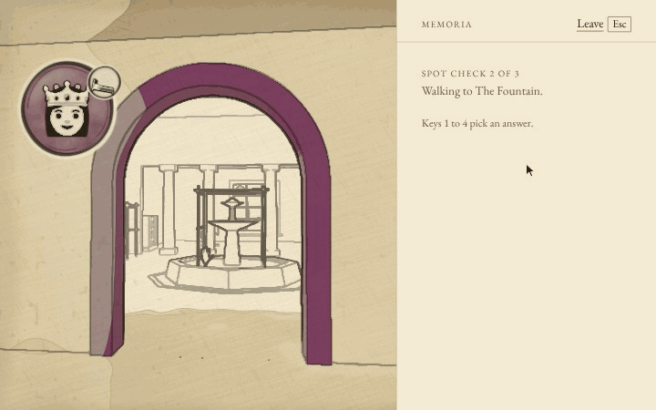
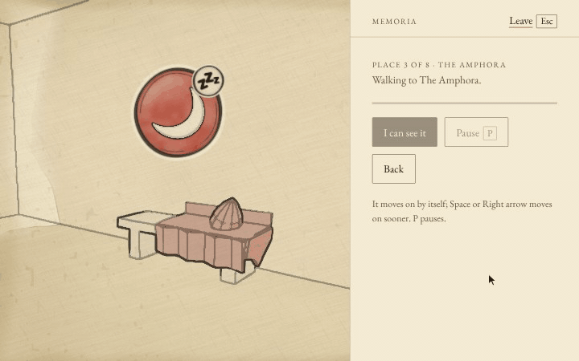
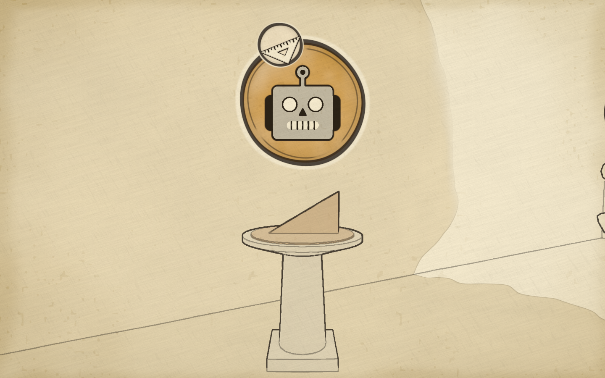

# Memoria

**Paste what you need to learn, and an AI architect turns it into a memory palace you can walk through.** You walk it to encode, walk it again with the images hidden to recall, and the palace schedules your reviews.



*One place on the recall walk: the question, a right answer, then the place takes full colour and an ink ring spreads on the floor.*


The palace starts as a line drawing. A place takes a light first glaze when an image is put there, and full colour when you recall what you left.

| | |
|---|---|
|  |  |
| Encode: the image appears at its place with its term, meaning and scene. | Recall: "What did you leave at this place?", with the image hidden until you answer. |
|  |  |
| Results: the score, place by place, while the camera revisits the places just walked. | First glaze: a place that holds an image but has not been recalled yet. |

## Try it

Live demo: (link added once deployed)

Demo video: [`docs/media/demo-pitch.mp4`](docs/media/demo-pitch.mp4), silent footage of the whole pitch run, about 85 seconds. It was rendered offline, frame by frame on a virtual clock, by `scripts/capture.mjs`. It is not a screen recording from a laptop.

Press "Try it in 2 minutes" on the title screen. That is Judge Mode: it loads the eight carpal bones of the wrist, walks you past one image per bone, then hides the images and asks what you left at each place. A run in which nothing is skipped measures about two minutes (120 seconds with two seconds of thought per answer); it takes longer if you think longer. Timed stops can be paused with the Pause button or the P key. It runs with the network off.

For a live pitch, open `/?judge=pitch`. The button then reads "Try it in 90 seconds": each of the eight places is shown for 4 seconds, then four of the eight are spot-checked. Measured length: 83 to 89 seconds.

## What it does

1. **Paste.** A list (one item per line, optionally `term - meaning`) or raw notes.
2. **The Architect proposes.** The Palace Architect picks the facts, drafts one image per fact, and assigns each to a place on a fixed route through the palace, keeping related items in the same room.
3. **You read through and edit.** You see every image before anything is placed and can rewrite or regenerate any of them. Nothing forces an edit. A draft survives a reload.
4. **Familiarize.** The first time you use a palace you take a short walk of the empty route, so you know the places before anything is put in them.
5. **Encode walk.** The camera glides from place to place. At each one the image appears in the room with its term, meaning and scene. You set the pace.
6. **Recall walk.** The same route with the images hidden. Each place asks "What did you leave at (this place)?" and the answer is the item's term, typed or multiple choice, before anything is revealed. Typed answers ignore articles, brackets and small typos, and a typed miss can be overruled with "I was right" (the results then show it as self-marked). Answers are saved as they are given, so a walk can be resumed after a reload. At the end you get a score and a tour of the places you just walked. For anything you missed, "Strengthen this image" offers another image; every item in the five built-in decks has a hand-written alternate.
7. **Spaced review.** Recall results move each item through Leitner boxes with growing intervals. A first correct answer is next due tomorrow, a miss is due again in 10 minutes, and later gaps grow to 3, 7 and 21 days. A "due" view walks only the places that need review.

The palace, "Domus", has twelve places in three rooms (the Vestibule, the Atrium, the Study). Five decks are built in: the eight carpal bones (Judge Mode), the twelve cranial nerves, the Mohs hardness scale, Spanish in the kitchen (term-and-meaning pairs) and the citric acid cycle.

Everything is stored in your browser's localStorage. There are no accounts. Saved data that is malformed is repaired or set aside, never shown as a blank page, and if something does go wrong an error page offers Reload and a guarded Reset.

## The comparison test

`/?compare` is a small test for volunteers, built so the team can collect honest, informal numbers. A volunteer learns one eight-item list as plain text and another by walking the palace (51 seconds each), does 20 seconds of sums after each, and answers eight ordered multiple-choice questions on each. Two lists exist in both forms (the carpal bones and the citric acid cycle), so which list goes in the palace is swapped between volunteers, as well as which comes first. The results table, the means and a CSV export stay on the device. The protocol and its limits are in [`docs/venue-test.md`](docs/venue-test.md).

No people have done it yet. The scores in `docs/media/ui-compare.png` were entered by a script. It is not a study, and we will not call it one.

## Why it should work, and what we do not claim

All of this comes from [`docs/research.md`](docs/research.md), which lists every source and how confident we are in it.

- The oldest surviving description of the method of loci is in the *Rhetorica ad Herennium*, written around the 80s BCE. The palace follows the rules for places found there and in Cicero: a fixed order, distinct forms, no crowds, and a marker on every fifth place.
- Two meta-analyses report that the method of loci improves recall of lists by a medium-to-large margin (g = 0.65 across 13 randomised trials; d = 0.88 for immediate serial recall against rehearsal). Both flag a high risk of bias, and the 2025 review grades the evidence as low to very low quality.
- A 2012 study of 142 participants found that a virtual environment explored for about five minutes served as well as a familiar real place. That is why Memoria uses a fixed virtual route with a familiarization walk. Participants in that study imagined their items, so our rendered images go beyond what it tested.
- The palace only helps you encode. What the literature shows makes memories last is retrieval practice and spacing, so every palace ends in a recall walk with the images hidden, followed by scheduled reviews.

What we do not claim:

- **We have not run an efficacy study of Memoria.** It is a hackathon prototype with no outcome data of its own. Every claim above is about the technique, not about this app.
- Our sources were checked through abstracts and search extracts, not full texts. `docs/research.md` marks what was not re-checked.
- The evidence is mostly short laboratory studies with university students memorizing word lists. Classroom evidence is thin.
- Loci suit ordered, discrete facts. They do not teach understanding.
- A browser is the desktop condition. The one head-to-head study we found reported head-mounted VR better than desktop, and other work suggests navigation itself may not be the active ingredient. The 3D walk is there for structure and engagement, not as a proven memory boost.
- AI-supplied images are not known to work as well as images the learner invents. The research on supplied versus self-made mnemonics is mixed, which is why you can rewrite every image.
- The large gains in training studies followed about six weeks of daily practice in young adult men. We do not promise general memory improvement, only what is practised.
- Other AI-assisted memory palace tools exist. Memoria is not the first.

## How it is built

**Stack.** Vite 8, React 19, TypeScript 6, three.js 0.187 with React Three Fiber 9, drei and postprocessing, zustand for state. WebGL2. The front end is static and deploys on Vercel. The only server code is one function, `api/architect.ts`.

**Layout, Theme, Style.** Three things are kept separate so that any palace works with any look:

- A **layout** (`src/layouts/`) is geometry plus the ordered route of places. Meshes never choose a colour. They name a semantic slot (`<Surface slot="wall" />`), and a place feature adds an accent role.
- A **theme** (`src/themes/*.json`) is a file of tokens: palette, light, fog, post-processing numbers, type, UI colours.
- A **style** (`src/styles/<id>/`) is code that turns theme tokens into materials, environment and post-processing.

The default look, Ink & Vellum, is a custom non-photorealistic pipeline: flat watercolour washes, ink outlines found from depth and surface direction, and paper grain, with no lights or shadow maps.

**The development field.** Every material can ask `developmentAt(worldPosition)`, a value from 0 to 1 that says how well the nearest place has been learned. Styles draw low values as unfinished and high values as complete. In the ink style an unlearned place is line on bare vellum, a place that holds an image carries a light first glaze, and a correct recall brings the full washes and pigment in around it, with an ink ring spreading on the floor.

**Camera.** The camera glides on a spline rail. Its turn rate is capped so that wide turns of the head stay calm, and the adaptive render resolution survives window resizes.

**The Palace Architect.** The server function makes two model calls for a new deck, and the app shows each step to the learner in plain words:

1. *Plan*: choose the facts, decide whether the deck is an ordered list or term-and-meaning pairs, and group related items by room.
2. *Generate*: draft one image per fact, acting on the feature of its place.
3. *Self-check*: a second, strict pass checks every image against the image rules (concrete, doing something, different from its neighbours, tied to the meaning by a one-line reason).
4. *Revise*: the images that fail are rewritten.
5. *Adapt*: when you miss an item in a recall walk, you can ask for a stronger image for that item.

The Anthropic key is read from the server environment and never reaches the browser. Results are cached. This live path is built but has not yet been run against the real model, because there is no API key yet.

**The offline planner.** If the function is unreachable or has no key, the app falls back to a deterministic offline planner, so composing a palace still works without a network. From notes it keeps each whole sentence as the meaning and names the card with a noun phrase that is unique in the deck. It never repeats a picture within a deck. For vocabulary, the image depicts the meaning and quotes the word, in several sentence patterns. Its drafts are labelled as offline drafts in the app.

**Offline demo path.** Judge Mode and the built-in decks run from fixtures. Nothing on the demo path makes a network request.

## Run it locally

Needs a current Node.js.

```bash
npm install
npm run dev
```

For the live Architect, copy `.env.example` to `.env.local` and set `ANTHROPIC_API_KEY`. The dev server serves the same `api/architect.ts` handler that Vercel runs. Without a key the app uses its offline planner. `ARCHITECT_MODEL` and `ARCHITECT_EFFORT` are optional overrides, described in `.env.example`.

| Command | What it does |
|---|---|
| `npm run dev` | Vite dev server |
| `npm run build` | Type-check, then production build to `dist/` |
| `npm run check` | Type-check and lint |
| `npm run shots` | Headless screenshots of fixed camera bookmarks into `qa/shots/` |
| `node scripts/smoke.mjs` | End-to-end test of the learning loop in headless Chromium: Judge Mode (passive, with misses, offline, the pitch variant), a keyboard-only compose and walk, typed recall, drafts and walks that survive a reload, malformed saved data, the error page, and the Theme Lab buttons with real clicks. Run `npm run build` first. |
| `node scripts/ab-smoke.mjs` | End-to-end test of the comparison test (`?compare`): two scripted participants with the lists swapped, the results table and CSV, and an abandoned run that stores nothing. Run `npm run build` first. |
| `node scripts/architect-smoke.mjs` | Checks the fixture decks, the offline planner and the API handler's guard rails. Calls the real model only when a key is set. |
| `node scripts/capture.mjs` | Renders footage, GIFs and interface stills frame by frame on a virtual clock, so motion plays at the right speed on a machine that draws only a few frames a second. The commands that made the files in `docs/media/` are in its header. Needs `ffmpeg` for video and GIF output. |

`shots`, `smoke.mjs`, `ab-smoke.mjs` and `capture.mjs` need Playwright: `npm i -D playwright && npx playwright install chromium`.

## URL switches

| Parameter | Effect |
|---|---|
| `?judge` | Starts Judge Mode (about 2 minutes) |
| `?judge=pitch` | The pitch variant, about 90 seconds (measured 83 to 89): waits on the title screen, shows each of eight places for 4 seconds, then spot-checks four of the eight |
| `?compare` | The list-against-palace comparison test for volunteers (protocol in `docs/venue-test.md`). Order and material are drawn at random. |
| `?compare=list-first`, `?compare=palace-first` | The same test with the order fixed |
| `&palace=carpals`, `&palace=krebs` | Added to `?compare`: fixes which list is walked in the palace (the carpal bones or the citric acid cycle); the other one is the plain list |
| `?lab` | Theme Lab: a panel for tuning the active theme's tokens live, with Copy JSON, Download JSON and Reset |
| `?perf` | Frame-rate overlay |
| `?theme=<id>` | Use a theme by id, for example `?theme=ink-sanguine` |
| `?proto=1` | The art-direction test room used to compare the three prototypes |

## Themes

| Id | Status |
|---|---|
| `ink-vellum` | Default. Iron-gall ink line over vellum with mineral-pigment washes. |
| `ink-sanguine` | Palette variant of the same style: red chalk on cream paper. |
| `cyanotype` | Experimental. |
| `nocturne-atrium` | Experimental; a prototype from the art-direction comparison. |
| `greybox` | Plain fallback, and the simplest template for a new style. |


To add a palette variant, copy the nearest JSON file in `src/themes/`, change its `id` and `name`, and edit the tokens. Themes are discovered automatically, so there is no code to write. A new style module is only needed when the way the picture is made changes. The full procedure, including the screenshot checks, is in [`.claude/skills/palace-theme-authoring/SKILL.md`](.claude/skills/palace-theme-authoring/SKILL.md).

## Accessibility

What exists today:

- **Keyboard only.** The whole loop can be done without a pointer: Right or Space for the next place, Left to go back, P to pause a timed stop. The end-to-end test composes a list and walks encode and recall with the keyboard only.
- **Reduced motion.** Follows the operating system's setting and can be overridden under Settings on the title screen. The camera glide is replaced with a cross-fade.
- **Contrast.** Overlay colours come from theme tokens, with a rule of at least 4.5:1 for text. The first QA review measured the overlay and found nothing below that; it has not been measured again since.
- **Text size.** Overlay text is at least 16 px.
- **Structure.** The overlay has a main landmark and headings. It has not been tried with a screen reader.

## Status

Checked by automated tests on the merged build (Saturday 14 November, 7:55 AM ET):

- The end-to-end suite (`scripts/smoke.mjs`, 13 of 13 cases), the comparison-test suite (`scripts/ab-smoke.mjs`, 3 of 3) and the Architect suite (`scripts/architect-smoke.mjs`, without the live model call) all pass.
- The Theme Lab's Copy JSON, Download JSON and Reset buttons are exercised with real clicks by the end-to-end suite.
- Two QA reviews by reviewers with no knowledge of the build are in [`docs/qa/`](docs/qa/). The second found no blockers; its four major issues were fixed afterwards and are covered by tests.

Not verified:

- **Frame rate on a real laptop.** The target is 60 fps at 1440×900 on an integrated GPU. It has not been measured.
- **Live motion on a real GPU.** Camera glides, the recall flourish and the results tour have been checked only in offline-rendered frames, not live.
- **The live Architect.** Built, but never run against the real model: there is no API key yet. The offline planner is what has been tested.
- **Any result with real people.** The comparison test is built and nobody has done it yet.
- **Screen readers.** Not tested.

Also:

- Moving an item to a different place by hand is not built.
- Not deployed yet.

## Roadmap

Stretch goals, in order:

1. A second palace layout (so a second topic gets its own route) and ambient audio.
2. AI-drawn images for the memory tokens.
3. A palace editor: click to place or reorder places in a layout.
4. A shareable palace link, with the palace encoded in the URL.
5. A WebXR mode.

Already built beyond the first plan: the comparison test (`?compare`), with the two lists and the order swapped between volunteers. Running it with people is the next step.

Later:

- Your own home as a palace, from a phone scan.
- A community theme gallery.
- Classroom mode: a teacher builds a palace and students walk it.
- Multilingual vocabulary packs.

## Built at HackPrinceton Fall 2026

Education track. Team: Alex Wang, Richard Xu, Eric Wang, Eric Chen.

The code was written with Claude Code agents under the team's direction during the hackathon window. The team chose the idea, the scope and the art direction, and reviewed the result. The agent roles and the rules they worked under are in [`CLAUDE.md`](CLAUDE.md) and [`.claude/agents/`](.claude/agents/).

## License and credits

MIT. See [LICENSE](LICENSE). Third-party libraries, fonts and assets are listed in [CREDITS.md](CREDITS.md). Geometry and shaders are procedural and original unless listed there.
